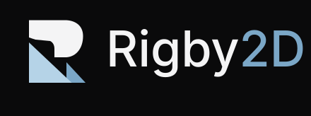
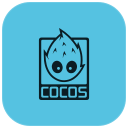
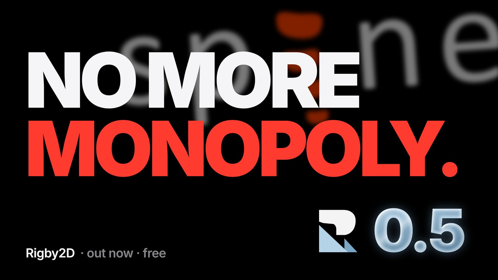
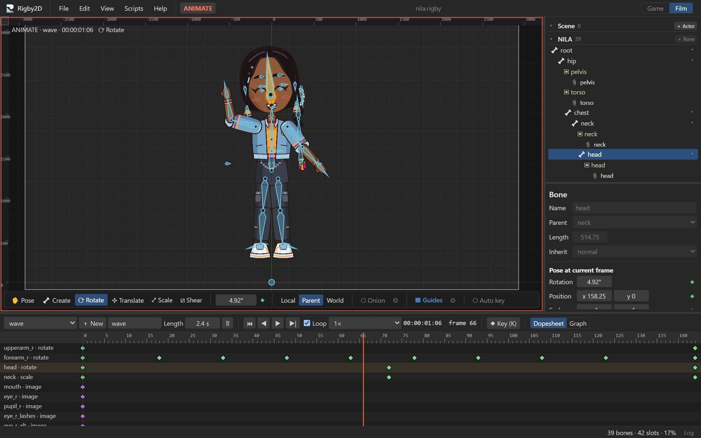

<p align="center">
  
</p>

<p align="center">
  <b>English</b> · <a href="readme/README.ja.md">日本語</a> · <a href="readme/README.zh-CN.md">简体中文</a> · <a href="readme/README.ko.md">한국어</a> · <a href="readme/README.es.md">Español</a> · <a href="readme/README.pt-BR.md">Português (Brasil)</a>
</p>

<h3 align="center">Open-source 2D skeletal animation for games and film.</h3>

<p align="center">
  Rig your art with bones and meshes, animate it, render it as film, and ship it to any game engine. Free forever.
</p>

<p align="center">
  <a href="https://rigby2d.com/editor/"></a>
  <a href="https://rigby2d.com/#download"></a>
  <a href="https://discord.gg/PGgaTwbNH"></a>
  <br>
  <sub>Windows · macOS · Linux · or the full editor in your browser, nothing to install</sub>
</p>

<p align="center">
  <a href="https://rigby2d.com/">Website</a> · <a href="https://rigby2d.com/docs/">Documentation</a> · <a href="https://rigby2d.com/blog/">Devlog</a> · <a href="https://rigby2d.com/addons/">Add-ons</a>
</p>

<p align="center">
  <a href="https://alternativeto.net/software/rigby2d/about/?utm_source=badge&utm_medium=referral"></a><br>
  <sub>Listed on AlternativeTo next to Spine, DragonBones and Live2D</sub>
</p>

<h3 align="center">Plays in the engine you already use</h3>

<table align="center">
  <tr>
    <td align="center" width="104"><a href="runtimes/godot/addons/rigby2d/README.md"><br><b>Godot</b></a><br><sub>4.3+</sub></td>
    <td align="center" width="104"><a href="runtimes/unity/com.rigby2d.unity/README.md"><br><b>Unity</b></a><br><sub>2021.3+ · 6</sub></td>
    <td align="center" width="104"><a href="runtimes/defold/README.md"><br><b>Defold</b></a><br><sub>1.14+</sub></td>
    <td align="center" width="104"><a href="runtimes/cocos/README.md"><br><b>Cocos Creator</b></a><br><sub>3.8</sub></td>
    <td align="center" width="104"><a href="runtimes/phaser/README.md"><br><b>Phaser</b></a><br><sub>3.60+ · 4</sub></td>
    <td align="center" width="104"><a href="runtimes/pixi/README.md"><br><b>PixiJS</b></a><br><sub>8 · WebGPU</sub></td>
    <td align="center" width="104"><a href="docs/runtimes.md#javascript"><br><b>JavaScript</b></a><br><sub>any engine</sub></td>
    <td align="center" width="104"><a href="runtimes/README.md"><br><b>Rust</b></a><br><sub>native</sub></td>
  </tr>
</table>

<p align="center"><sub>Eight free, open-source runtimes. Each plays the same animation as the editor, frame for frame.</sub></p>

<p align="center">
  <a href="https://upstar.dev/r/jaisurya-dev-art/rigby2d">
    <picture>
      <source media="(prefers-color-scheme: dark)" srcset="https://upstar.dev/badge/jaisurya-dev-art/rigby2d/award/gamedev-engines-dark.svg">
      
    </picture>
  </a>
</p>

<p align="center">
  
  <a href="#license"></a>
  <a href="https://github.com/jaisurya-dev-art/rigby2d/stargazers"></a>
  <a href="CONTRIBUTING.md"></a>
</p>

<p align="center">
  <a href="https://youtu.be/I9G-ZbvNlGw"></a><br>
  <sub>▶ <a href="https://youtu.be/I9G-ZbvNlGw">Watch <b>Rigby2D 0.5</b></a>: everything new in 54 seconds · Also: <a href="https://youtu.be/3StZlHwZeSo">Meet NILA</a>, our mascot, animated in Rigby2D</sub>
</p>

<p align="center">
  <br>
  <sub>The editor animating NILA: the head bone selected in the tree, its keys in the dopesheet, its pose in the inspector.</sub>
</p>

## Featured in

- **Polydium (CG · VFX · Game Daily Briefing):** [Rigby2D — 레이어 PSD를 자동으로 리깅하는 오픈소스 2D 스켈레탈 애니메이션 에디터](https://polydium.net/briefing/8df9db93-0abf-4032-bd88-acbdf95ec431) — featured in the [Polydium Pipeline Briefing](https://polydium.net/briefing) for Korean game and VFX studios.
- **Portable Linux Apps:** [Rigby2D AppImage for Linux](https://portable-linux-apps.github.io/en/app/rigby2d.html) — listed in the AppImage catalog of the [AM package manager](https://github.com/ivan-hc/AM).
- **Open-source & AI indexes:** Listed in [Trendshift Top Game Engine Open-Source Projects (2026)](https://trendshift.io/topics/game-engine), [Nicheloom](https://www.nicheloom.com/launches/57217/), and [Context7](https://context7.com/jaisurya-dev-art/rigby2d).

## Documentation

**[Read the documentation](https://rigby2d.com/docs/)**: guides with screenshots for every part of the editor, the
runtimes and the MCP server. The pages are also in [`docs/`](docs/).

| Get started | Rig | Animate | Ship and automate |
| --- | --- | --- | --- |
| [Installation](https://rigby2d.com/docs/installation.html) | [Importing art](https://rigby2d.com/docs/importing-art.html) | [Animating](https://rigby2d.com/docs/animating.html) | [Export](https://rigby2d.com/docs/export.html) |
| [Quick start](https://rigby2d.com/docs/quick-start.html) | [AutoRig](https://rigby2d.com/docs/autorig.html) | [Graph editor](https://rigby2d.com/docs/graph-editor.html) | [Runtimes](https://rigby2d.com/docs/runtimes.html) |
| [The interface](https://rigby2d.com/docs/interface.html) | [Bones and slots](https://rigby2d.com/docs/bones-and-slots.html) | [Poses and faces](https://rigby2d.com/docs/poses-and-faces.html) | [Python scripting](https://rigby2d.com/docs/scripting.html) |
| [Demo projects](https://rigby2d.com/docs/demos.html) | [Meshes](https://rigby2d.com/docs/meshes.html) · [Constraints](https://rigby2d.com/docs/constraints.html) | [Film](https://rigby2d.com/docs/film.html) · [Scenes](https://rigby2d.com/docs/scenes.html) · [Lip-sync](https://rigby2d.com/docs/lip-sync.html) | [AI assistants (MCP)](https://rigby2d.com/docs/mcp.html) |

## Features

- **AutoRig**: a layered PSD or SVG becomes an editable rig in one step: bones, joints, bending meshes and IK.
- **Full rigging toolset**: bones, weighted meshes, linked meshes, image sequences, skins, events,
  clipping and paths, with IK, transform, path, physics and slider constraints.
- **Animation**: Setup and Animate modes, dopesheet, graph editor with Bézier handles, onion
  skinning, pose library, face controls and retargeting between characters.
- **Film workspace**: 4K, timecode, an animatable camera, audio tracks, viseme lip-sync with
  on-device Whisper transcription, and renders to PNG sequences, WebM with alpha and MP4.
- **Scene composition** (new in 0.3): several characters on one stage as actors with NLE-style clips
  (trim, speed, loops, crossfades, their own audio), painted layers with parallax, and a camera,
  and they play in games through the Godot, Unity, Cocos Creator, Phaser, PixiJS, JavaScript and Rust runtimes. See [Scenes](https://rigby2d.com/docs/scenes.html).
- **A focused editor**: Game and Film workspaces, panels you can resize or pop out to a second
  monitor, *Open recent*, and a searchable shortcut reference with Reference and Blender-like keys.
- **Your work is safe**: saves that never leave a half-written file, `.rigby1` backups like Blender's
  `.blend1`, auto-save, and crash recovery that offers unsaved work back at the next start.
  See [Saving and recovery](https://rigby2d.com/docs/recovery.html).
- **Preferences and add-ons**: *Edit ▸ Preferences* for the language (English, Japanese, Chinese,
  Korean, Spanish, Portuguese), interface scale, shortcuts, undo steps, backups and auto-save, and an
  add-on gallery for sandboxed Python add-ons that add tools.
  See [Add-ons](https://rigby2d.com/docs/addons.html).
- **Welcome screen, auto-update and runtimes from the editor**: new projects, recent work, starter
  projects and lessons at startup; signed updates in the desktop app; *File ▸ Get runtimes* for Unity,
  Godot, Defold, Cocos Creator, Phaser and PixiJS.
- **Coming from other tools**: opens Spine exports (with a migration checker) and DragonBones
  projects. See [Coming from Spine](https://rigby2d.com/docs/migrating-from-spine.html) and
  [Coming from DragonBones](https://rigby2d.com/docs/migrating-from-dragonbones.html).
- **Python scripting** and custom tools, and a built-in **MCP server** so AI assistants such as
  Claude can inspect, rig and animate your projects.
- **Lossless skeleton JSON (3.8, 4.2, 4.3) and binary `.skel`** with texture atlases, played by the
  **JavaScript, Phaser, PixiJS, Rust, C++ (Defold), Unity, Godot and Cocos Creator runtimes**.
- **Sprite sheets** for engines that play frames: packed with TexturePacker/Aseprite-style JSON, a
  Defold atlas, or PNG frames, with loops that join up (also from the MCP server).
- Built-in **tutorials** and demo projects (**NILA**, **Rigbytron**, and a **scene** with both), also on the
  [Demos page](https://rigby2d.com/demos/) with their game-ready exports
  (demo content © Rigby2D, under its own [demo license](branding/DEMO-LICENSE.md)).

## Getting started

- **In your browser:** [open the editor](https://rigby2d.com/editor/), nothing to install.
- **Windows:** [download the portable editor](https://github.com/jaisurya-dev-art/rigby2d/releases/latest/download/Rigby2D_x64_portable.exe)
  or an installer from [Releases](https://github.com/jaisurya-dev-art/rigby2d/releases).
- **macOS:** [download the .dmg](https://github.com/jaisurya-dev-art/rigby2d/releases/latest/download/Rigby2D_universal.dmg)
  (Apple silicon and Intel). **Linux:** [download the AppImage](https://github.com/jaisurya-dev-art/rigby2d/releases/latest/download/Rigby2D_amd64.AppImage)
  or the `.deb` from [Releases](https://github.com/jaisurya-dev-art/rigby2d/releases). See
  [Installation](https://rigby2d.com/docs/installation.html) for the first start.
- **AI assistants:** install [Rigby2D-AI.mcpb](https://github.com/jaisurya-dev-art/rigby2d/releases/latest/download/Rigby2D-AI.mcpb)
  in Claude Desktop, or see the [MCP guide](https://rigby2d.com/docs/mcp.html).
- **From source** (Node.js 20+ and the [Tauri prerequisites](https://tauri.app/start/prerequisites/)):

```bash
git clone https://github.com/jaisurya-dev-art/rigby2d.git
cd rigby2d
npm install
npm run dev        # desktop app; npm run web:dev for the browser, npm test for the tests
```

See [Installation](https://rigby2d.com/docs/installation.html) for every option.

## Project structure

```
src/core/       Runtime: data model, skeleton JSON/.skel + atlas I/O, pose evaluation, constraints, playback
src/editor/     Editor UI: viewport, tree, inspector, dopesheet, graph editor, import/export, scripting
src/webgl/      Reference WebGL renderer for the runtime
src/mcp/        Model Context Protocol server for AI assistants
runtimes/       Rust, C++ (Defold), Godot, Unity, Cocos Creator, Phaser and PixiJS runtimes
site/           Website and documentation site (GitHub Pages)
docs/           Documentation pages and images
branding/       Logo, icons, Rigbytron and NILA (proprietary, see TRADEMARKS.md)
src-tauri/      Native desktop shell
test/           node:test suites
```

## Support Rigby2D

Rigby2D is free and open source, and it stays that way. Monthly support pays for what one person
can't, starting with **code signing in Rigby2D's name**, so Windows and macOS stop warning the people
who download it. The first goal is $25 a month; the first 20 monthly supporters are Founding Supporters.

<a href="https://github.com/sponsors/jaisurya-dev-art"></a>
&nbsp;[Where the money goes](https://rigby2d.com/fund/)

## Contributing

Contributions are welcome! Please read [CONTRIBUTING.md](CONTRIBUTING.md) for the development setup,
coding style and pull request process.

## License

Rigby2D's source code is licensed under either of

- [MIT License](LICENSE-MIT)
- [Apache License, Version 2.0](LICENSE-APACHE)

at your option. © 2026 [jaisurya-dev-art](https://github.com/jaisurya-dev-art)

Unless you state otherwise, any contribution you submit for inclusion in Rigby2D is licensed under
both licenses as above, without any additional terms or conditions.

The editor distributes Pyodide and CPython for Python scripting under their own licenses; see
[THIRD_PARTY_NOTICES.md](THIRD_PARTY_NOTICES.md).

## Trademarks

**Rigby2D**, **Rigbytron** and **NILA**, and the Rigby2D logo, lockups, icons and the Rigbytron
and NILA mascots in [`branding/`](branding/), are proprietary trademarks of the Rigby2D project. They are not covered by the MIT or Apache 2.0 licenses. Forks
and modified versions must use their own name and branding. See [TRADEMARKS.md](TRADEMARKS.md).

The DragonBones demo characters on the website ([`site/showcase/dragonbones/`](site/showcase/dragonbones/))
are © The DragonBones team and other contributors, under CC BY-NC-SA 4.0, not the Rigby2D license.

## Disclaimer

Rigby2D is an independent open-source project. It is not affiliated with, endorsed by, or sponsored by the makers of any other animation software. All trademarks belong to their respective owners.

Rigby2D reads and writes the skeleton JSON, binary `.skel` and texture atlas file formats solely for interoperability, so that users can work with their own exported files. This support was implemented clean-room:

- **JSON and atlas formats:** implemented from publicly available documentation.
- **Binary `.skel` format:** implemented from the publicly documented binary layout of earlier versions and by comparing JSON and binary exports of the same skeleton (black-box observation of exported data).

No source code, runtimes, editor files or assets of other animation software are used or distributed with Rigby2D. Compatibility with files from any particular editor or runtime version is provided as-is and is not guaranteed.
