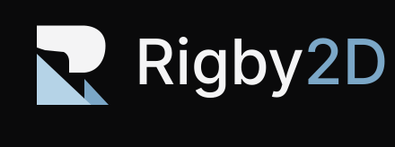
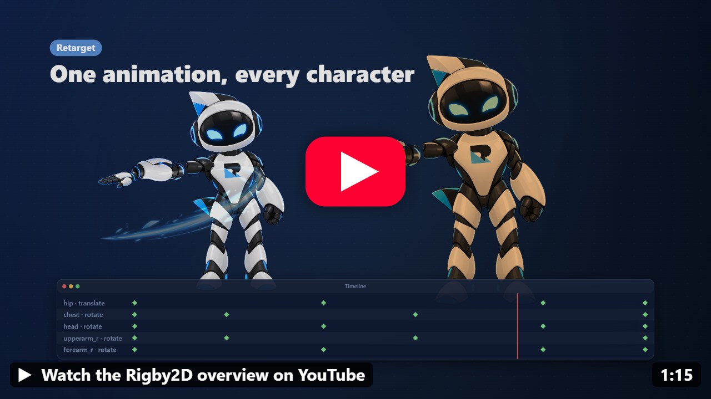
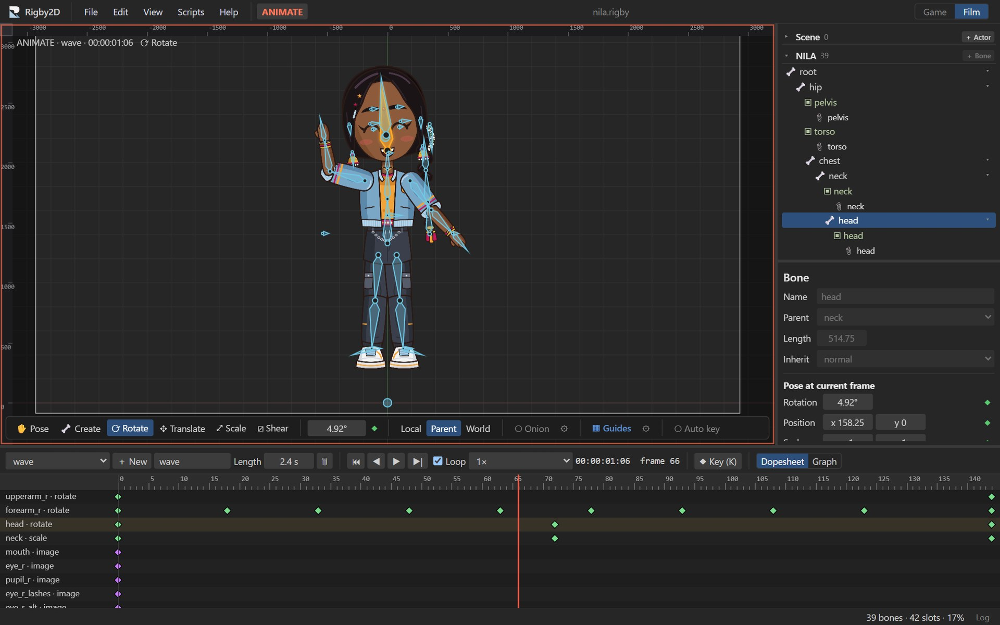

<p align="center">
  
</p>

<p align="center">
  <strong>Open-source 2D skeletal animation for games, films and interactive experiences.</strong><br>
  Rig your art with bones and meshes, animate it, and play it anywhere with the included runtime.<br>
  Built-in <a href="docs/mcp.md">MCP server</a>: AI assistants can inspect, validate and animate your projects.
</p>

<p align="center">
  <a href="https://jaisurya-dev-art.github.io/rigby2d/"></a><br>
  <sub><a href="https://jaisurya-dev-art.github.io/rigby2d/editor/"><b>Open the editor</b></a> with the Rigbytron demo, tutorials and Python scripting · <a href="https://jaisurya-dev-art.github.io/rigby2d/">Website</a></sub>
</p>

<p align="center">
  
  <a href="https://upstar.dev/r/jaisurya-dev-art/rigby2d"></a>
  <a href="https://www.youtube.com/watch?v=KK3WT9YzhAE"></a>
  <a href="runtimes/godot/addons/rigby2d/README.md"></a>
  <a href="docs/mcp.md"></a>
  <a href="#license"></a>
  
  
  
  <a href="CONTRIBUTING.md"></a>
</p>

<p align="center">
  <a href="https://github.com/jaisurya-dev-art/rigby2d/releases/latest/download/Rigby2D_x64_portable.exe"><b>Download (portable)</b></a>: the latest portable editor for Windows, no install needed
</p>

<p align="center">
  <a href="https://www.youtube.com/watch?v=KK3WT9YzhAE"></a><br>
  <sub>▶ <a href="https://www.youtube.com/watch?v=KK3WT9YzhAE">Watch the 75-second overview</a>: AutoRig, animation, film, games and AI</sub>
</p>

<p align="center">
  
</p>

## Built for AI assistants (MCP)

Rigby2D ships a [Model Context Protocol](https://modelcontextprotocol.io) server, so assistants such
as Claude can work directly on your animation projects, not just talk about them:

- **Understand a rig**: list bones, slots, skins, constraints and animations with their keys.
- **Check it**: evaluate any pose with the real runtime, find missing images and export problems.
- **Animate it**: add bones and animations, set eased keys, image swaps and events.
- **Direct it**: set film output and camera framing, build pose libraries and face controls, add
  audio tracks and lip-sync a mouth to dialogue.
- **Rig it**: AutoRig a layered PSD into an editable rig, and retarget animations between
  characters.
- **Script it**: run Python scripts with the editor's `rigby` API for anything else, with
  tracebacks when something goes wrong.
- **Ship it**: convert between skeleton JSON 3.8 / 4.2 / 4.3 and binary `.skel`.

Ask things like *"Which images are missing from hero.skel?"* *"Add a 1-second wave animation to
rigbytron.rigby that raises the right arm and fires a 'hi' event at the end"*, or *"Add line.wav to the
talk animation and lip-sync the mouth control to it."* Edits save in the
file's own format and stay inside the folders you allow.

**Claude Desktop (Windows, macOS):** download
**[Rigby2D-AI.mcpb](https://github.com/jaisurya-dev-art/rigby2d/releases/latest/download/Rigby2D-AI.mcpb)**,
drag it onto the Claude Desktop window (or use *Settings ▸ Extensions ▸ Advanced settings ▸ Install
Extension…*), choose your project folders and click *Install*. Nothing else to install: Claude
Desktop brings everything the extension needs. The editor walks you through it in
*Help ▸ Connect an AI assistant*.

**Claude Code:** one line ([details](docs/mcp.md)):

```bash
claude mcp add rigby2d -- node /path/to/rigby2d/src/mcp/server.js --root /path/to/your/projects
```

## Workspaces: game and film

Rigby2D has two workspaces, switched at the top right of the editor:

- **Game**: rig and animate for game engines and apps, and export skeleton JSON or `.skel` with a
  texture atlas for the runtimes. The game workflow is unchanged.
- **Film**: animate for film, video and motion graphics: output resolution and frame rate,
  timecode, rendering to transparent PNG sequences, WebM and MP4, batch renders, and face controls.

A workspace only changes which tools are shown. Film settings never reach skeleton exports, so game
files are identical whichever workspace you use. See the [film guide](docs/film.md).

## Rigby AutoRig and animation retargeting

- **AutoRig**: import a layered PSD and get an editable rig in one step. Rigby2D identifies the
  body parts from the layer names (or their positions), places joints where the parts meet,
  builds the skeleton, turns bending parts into weighted meshes (a single arm layer gets an elbow)
  and adds IK for arms and legs.
- **Retargeting**: make an animation once and reuse it on other characters. Bones are matched
  automatically (`L_UpperArm` finds `upperarm_l`), and movement is scaled to each character's
  size. Different rest poses can be compensated.

Both are in the *File* menu, and the MCP server exposes them too. See the
[AutoRig and retargeting guide](docs/autorig.md).

## Python scripting and custom tools

Write Python scripts that edit the open project, and turn them into **custom tools** in the
**Scripts** menu. Python 3 is built in (Pyodide), so there is nothing to install, and scripts work offline.

```python
import rigby

@rigby.tool("Mirror selected bones")
def mirror():
    for bone in rigby.selected_bones():
        bone.set(x=-bone.x, rotation=180 - bone.rotation)
```

Each run is one undo step. A script that fails leaves the project untouched, and its traceback goes
to the **Log** window (*View ▸ Log*), which also collects the editor's own warnings and errors. See
the [scripting guide](docs/scripting.md).

## Features

- **AI assistant support (MCP)**: a built-in [Model Context Protocol](https://modelcontextprotocol.io) server lets assistants such as Claude inspect, validate, sample, edit and convert projects. See [Built for AI assistants](#built-for-ai-assistants-mcp).
- **Art import**: PSD files (every pixel layer becomes a part, layout preserved) or individual PNGs. For pixel art, set *Textures* to *Pixel art (nearest)* in the Project inspector: images stay sharp in the viewport and in renders, and exported atlases use `filter: Nearest, Nearest`, which the runtimes follow.
- **Rigby AutoRig and retargeting**: rig layered artwork in one step (bones, joints, meshes, IK), and reuse animations across characters with automatic bone mapping and proportion compensation. See the [guide](docs/autorig.md).
- **Rigging**: draw bone chains directly in the viewport, reparent, attach images to bones, reorder draw order, turn images into meshes (add, move and delete vertices), bind meshes to bones and paint weights, create linked meshes, set up image sequences, and edit bounding box, clipping and path shapes.
- **Constraints, skins and events**: create IK, transform, path, physics and slider constraints from the selected bones and edit every setting; key their mixes and values in Animate mode; key mesh deformation and image sequence frames; create skins (with skin bones and constraints) and events with keyed values; add bounding box, clipping, point and path attachments.
- **Animation**: Setup and Animate modes, pose / rotate / translate / scale / shear tools, key buttons and optional auto key, switchable shortcut presets.
- **Onion skinning**: see past and future frames as tinted ghosts behind the pose in Animate mode (*Onion* in the viewport toolbar), with frame counts, colors and looping; limit it to chosen bones and their children from the bone tree.
- **Film output** (Film workspace): resolution and frame rate presets (23.976, 24, 25 fps; 4K, 2K Scope and Flat, Full HD, vertical, square), transparent or colored background, automatic or fixed framing, timecode, audio tracks with lip-sync; render transparent PNG sequences, WebM (with alpha) and MP4, one animation or a batch of animations and skins. See the [film guide](docs/film.md).
- **Python scripting**: custom tools in the Scripts menu, a script editor, and a log window with tracebacks. See the [scripting guide](docs/scripting.md).
- **Pose library and face controls**: save poses (with mouth-shape image swaps), apply them at any amount or as keys, and drive faces with sliders that blend between poses.
- **Dopesheet and graph editor**: multi-key selection, moving and retiming keys, curve presets, bezier handle editing, image-swap keys.
- **WebGL viewport** with a Canvas 2D fallback (*View* menu).
- **Detachable panels and window layouts** (desktop app): pop the Timeline, Tree and Inspector out into their own windows, for example on a second monitor, and save the arrangements as named layouts to recall from *View ▸ Window layouts* or with Ctrl+Alt+<digit>.
- **Undo / redo** for every edit, with unsaved-change tracking (including edits made while the timeline plays).
- **`.rigby` work file**: one self-contained file with the whole project and its images (like a `.blend`).
- **Skeleton import/export**: opens and exports the widely used skeleton formats: `.json` (3.8, 4.2, 4.3) and binary `.skel` (4.3), with `.atlas` texture atlases. Meshes, weights, skins, constraints, events, deform and draw-order keys round-trip losslessly.
- **Runtimes included**: a small dependency-free JavaScript runtime (`src/core`) with animation tracks, events, image sequences, IK, transform, path, physics and slider constraints, plus a reference WebGL renderer (`src/webgl`). A Rust port of it, 3 to 4× faster, powers the Godot runtime (preview, [`runtimes/`](runtimes/)).
- **Built-in tutorials**: interactive lessons in *Help ▸ Tutorials*, with a practice character included, so beginners learn by doing.
- **Demo project**: the editor opens with Rigbytron, the Rigby2D mascot, rigged and animated, so you can explore a real rig right away (*File ▸ Open demo (Rigbytron)* reopens it). *File ▸ New sample (robot)* gives a simpler character drawn by the editor.

## In progress

Rigby2D is in early alpha. Work under way:

- **Godot and Unity runtimes**: a Rust runtime with full feature support. The Rust core and the
  Godot 4 node (`RigbySkeleton2D`) are available in preview ([`runtimes/`](runtimes/), Windows x64
  download on Releases); Unity is next.
- **Scene composition** (Film workspace): several characters in one shot.

Done in this cycle: the offline renderer (PNG sequences, WebM, MP4), resolution and frame-rate
controls, the batch renderer, the pose library and face controls, and audio tracks with
loudness-driven lip-sync (mixed into WebM and MP4 renders), and an animatable camera.

New since 0.2.5: detachable panels ([#3](https://github.com/jaisurya-dev-art/rigby2d/pull/3)), saved
window layouts ([#6](https://github.com/jaisurya-dev-art/rigby2d/pull/6),
[#12](https://github.com/jaisurya-dev-art/rigby2d/pull/12)), onion skinning
([#10](https://github.com/jaisurya-dev-art/rigby2d/pull/10)), edits made during playback now mark
the project unsaved ([#4](https://github.com/jaisurya-dev-art/rigby2d/pull/4)), and a pixel-art
texture filter ([#11](https://github.com/jaisurya-dev-art/rigby2d/issues/11)). Thanks to
[@maruccimauro](https://github.com/maruccimauro) for the panels, layouts, onion skinning and
playback fix.

## Getting started

### Try it in your browser

**[Open the editor](https://jaisurya-dev-art.github.io/rigby2d/editor/)** on the
[Rigby2D website](https://jaisurya-dev-art.github.io/rigby2d/): the full editor with the Rigbytron
demo, the tutorials and Python scripting, with nothing to install. Files open and save through your
browser (folder access where the browser supports it, otherwise a download). Detachable panels and
window layouts need the desktop app. The website and its editor follow the `develop` branch.

### Download

**[Download (portable)](https://github.com/jaisurya-dev-art/rigby2d/releases/latest/download/Rigby2D_x64_portable.exe)**: the latest portable editor for Windows, a single `.exe`: download and open, no install.

All files are on the [Releases](https://github.com/jaisurya-dev-art/rigby2d/releases) page:

- **Windows editor**: an installer (MSI or setup `.exe`), or the portable `.exe` that runs without
  installing (needs WebView2, included in Windows 10 and 11).
- **Godot runtime** (preview, Windows x64): the `rigby2d-godot-addon` zip for your project, or the
  `rigby2d-godot-demo` project. See the [Godot guide](runtimes/godot/addons/rigby2d/README.md).

The files are **not code-signed** yet, so Windows SmartScreen may warn before running them
(*More info ▸ Run anyway*). Each release lists the SHA-256 checksums of its files; compare them
before running anything:

```powershell
Get-FileHash .\Rigby2D_0.2.6_x64_en-US.msi -Algorithm SHA256
```

To build from source instead, follow the steps below.

### Prerequisites

- [Node.js](https://nodejs.org) 20 or newer
- Tauri's system prerequisites for your OS, see <https://tauri.app/start/prerequisites/>
  - **Windows:** Microsoft C++ Build Tools ("Desktop development with C++") and WebView2 (preinstalled on Windows 10/11)
  - **macOS:** Xcode Command Line Tools
  - **Linux:** WebKitGTK and build essentials

### Run

```bash
git clone https://github.com/jaisurya-dev-art/rigby2d.git
cd rigby2d
npm install
npm run dev
```

### Build a release

```bash
npm run build
```

The app is written to `src-tauri/target/release/` and the installers (MSI and NSIS setup `.exe`) to
`src-tauri/target/release/bundle/`.

### Test

```bash
npm test
```

### Website

```bash
npm run site:build
```

Builds the website (`site/`) and the browser editor (served at `/editor/`) into `_site/`. Every push
to `develop` deploys it to GitHub Pages through `.github/workflows/pages.yml`.

## Using Rigby2D

**New to animation tools? Start with the built-in tutorials:** *Help ▸ Tutorials*. They are short, hands-on lessons that point at the buttons to use and move on as you go. They take you from finding your way around to rigging a character with AutoRig, drawing bones by hand, and making your first animation. The first time the editor opens, it offers the tour.

The editor opens with the Rigbytron demo; *File ▸ New game project* or *New film project* starts an empty one.

1. **Import art:** *File ▸ Import PSD…* or *File ▸ Import PNG images…*
2. **Draw bones:** pick the *Create* tool in the viewport toolbar and drag. Select a bone first to chain children from it.
3. **Attach images:** select an image and choose its *Bone* in the inspector.
4. **Animate:** switch to Animate mode, move the time cursor and pose bones, then set keys with the key buttons (or turn on *Auto key*). The *Help* menu lists the keyboard shortcuts.
5. **Save:** *File ▸ Save* writes your work file `name.rigby`. Reopen it any time with *File ▸ Open*.
6. **Export:** *File ▸ Export JSON + atlas…* or *Export .skel + atlas* writes the skeleton plus `name.atlas` and `name.png` for runtimes. *File ▸ Open* also imports existing `.json` / `.skel` exports.

## Playing animations in your game or app

The runtime plays Rigby2D animations in games, interactive web pages, apps and kiosks, anywhere
JavaScript runs. Copy `src/core/` into your project (no dependencies). With WebGL, also copy `src/webgl/` for a
ready-made renderer (one batched draw call per texture and blend mode, two-color tint, clipping):

```js
import { AnimationState, Pose, parseAtlas, readSkeletonJson } from './core/index.js';
import { WebGLRenderer } from './webgl/renderer.js';

const { skeleton } = readSkeletonJson(JSON.parse(jsonText), 'hero'); // hero.json
const pose = new Pose(skeleton);
const state = new AnimationState();
state.play(skeleton, 'walk', true, 0.2);              // track 0, 0.2 s crossfade
state.setAnimation(skeleton, 1, 'shoot', false, 0.1); // track 1 layers on top
state.addAnimation(skeleton, 0, 'idle', true, 0.3);   // queued after walk
state.addListener({ event: (entry, e) => playSound(e.audio ?? e.name) });

const renderer = new WebGLRenderer(gl);
const textures = renderer.atlasTextures(parseAtlas(atlasText), { 'hero.png': pageImage });

function frame(dt) {
  state.update(skeleton, dt);
  state.apply(skeleton, pose);
  renderer.begin(canvas.width, canvas.height, { x: 0, y: 200, zoom: 1 });
  renderer.drawSkeleton(skeleton, pose, textures);
  renderer.end();
}
```

With another renderer, draw `pose.quads(skeleton)`: world-space positions (Y up), UVs, tint and
blend mode for every visible region and mesh. `examples/webgl.html` is a small player: run
`npm run web:dev` and open `/examples/webgl.html`.

### File formats

- **`.rigby`**: Rigby2D's work file: a ZIP holding `project.json` (the complete document) and
  `images/*.png`. Use it for saving work in progress.
- **Skeleton `.json` / `.skel`**: the interchange formats runtimes load. Bones are listed so
  parents come first, slots are in draw order, attachments live in skins, and animations hold bone,
  slot, deform, draw-order, IK and event timelines with keys relative to the setup pose. Images
  come from a `.atlas` texture atlas or loose files in the skeleton's `images` folder.
- Binary `.skel` support covers format 4.3 skeletons with IK, transform, path, physics and
  slider constraints, skins, region and mesh attachments with image sequences, linked mesh,
  bounding box, path and clipping attachments, and bone, slot, IK, transform, path, physics,
  slider, deform, sequence, draw-order and event keys. Rigs using other features (point
  attachments, separate RGB/alpha color keys, …) export to `.json` instead.
- The runtime evaluates IK, transform, path, physics and slider constraints and plays image
  sequences (hold, once, loop, ping-pong and reverse modes). Physics uses Rigby2D's own
  spring model driven by the stored settings (inertia, strength, damping, mass, wind, gravity,
  limit, mix), so motion can differ slightly from other tools. It simulates while animations play
  (`AnimationState` passes the elapsed time); `pose.resetPhysics()` starts it over.

## MCP server reference

35 tools. Read and convert: `inspect_project`, `describe_rig`, `describe_animation`, `sample_pose`,
`validate_project`, `convert_project`. Edit: `add_bone`, `set_bone_setup`, `rename_bone`,
`add_animation`, `rename_animation`, `delete_animation`, `set_bone_key`, `delete_bone_key`,
`set_attachment_key`, `set_event_key`, `set_slot`, and `batch_edit` for many edits in one atomic call. Film, poses and audio (`.rigby`): `set_workspace`,
`set_output`, `save_pose`, `apply_pose`, `delete_pose`, `add_face_control`, `set_face_control`,
`delete_face_control`, `add_audio_track`, `set_audio_track`, `remove_audio_track`, `lip_sync`.
Rigging: `detect_parts`, `autorig`, `map_bones`, `retarget_animation`. Scripts: `run_script`
(Python; needs `npm install` once, as does reading PSD files). The server only
reads and writes inside the `--root` folders, and edits save atomically in the file's own format
(or to a copy). See [docs/mcp.md](docs/mcp.md) for Claude Desktop and other clients, every tool
and the security model.

## Performance benchmark (0.2.0)

Measured on a desktop PC in Chromium, Node 22 and Rust (release build); numbers vary with hardware.
Rigs are described by size: **M** has 67 bones and 276 mesh vertices, **L** 76 bones and 667
weighted mesh vertices with 9 IK constraints, **XL** 143 bones and 879 mesh vertices with 21
transform and path constraints.

**Runtimes**: animating one character for one frame (apply the animation, solve constraints,
compute world transforms and vertices), median of 2000 frames of the *walk* animation. JavaScript
is `src/core`; Rust is `runtimes/rust`, which also powers the Godot runtime:

| Rig | JavaScript | Rust | Characters per 16 ms frame (JS / Rust) |
| --- | ---: | ---: | ---: |
| M | 50 µs | 14.5 µs | ~320 / ~1,100 |
| L | 71 µs | 22 µs | ~225 / ~720 |
| XL | 90 µs | 22 µs | ~180 / ~730 |

**WebGL renderer** (`src/webgl`): 50 XL characters, each animated and drawn every frame, take
21.6 ms per frame including the GPU (0.43 ms per character) in a single draw call.

**Editor viewport**: drawing one animation frame with WebGL, median and 95th percentile of 120
frames:

| Rig | Median | 95th percentile |
| --- | ---: | ---: |
| M | 0.4 ms | 0.5 ms |
| L | 0.5 ms | 0.7 ms |
| XL | 1.0 ms | 1.6 ms |

## Project structure

```
src/core/       Runtime: data model, skeleton JSON/.skel + atlas I/O, pose evaluation, constraints, playback
src/editor/     Editor UI: viewport, tree, properties, dopesheet, graph editor, import/export
src/webgl/      Reference WebGL renderer for the runtime
src/splash/     Splash screen (plays the Rigbytron animation with the runtime)
src/mcp/        Model Context Protocol server for AI assistants
src/editor/scripting/  Python scripting: the rigby module, script host and script editor
runtimes/       Rust runtime and the Godot 4 node (preview); see runtimes/README.md
branding/       Logo, lockups, icons and Rigbytron (proprietary, see TRADEMARKS.md)
examples/       WebGL player example
site/           Website (GitHub Pages): landing page with Rigbytron playing live on the runtime
src-tauri/      Native desktop shell (editor and splash windows, file dialog/fs plugins only)
test/           node:test suites
docs/           Screenshot and the film, AutoRig, scripting and MCP server guides
```

## Contributing

Contributions are welcome! Please read [CONTRIBUTING.md](CONTRIBUTING.md) for the development setup,
coding style and pull request process.

## License

Rigby2D's source code is licensed under either of

- [MIT License](LICENSE-MIT)
- [Apache License, Version 2.0](LICENSE-APACHE)

at your option. © 2026 [jaisurya-dev-art](https://github.com/jaisurya-dev-art)

Unless you state otherwise, any contribution you submit for inclusion in Rigby2D is licensed under
both licenses as above, without any additional terms or conditions.

The editor distributes Pyodide and CPython for Python scripting under their own licenses; see
[THIRD_PARTY_NOTICES.md](THIRD_PARTY_NOTICES.md).

## Trademarks

**Rigby2D**, **Hoverlabs** and **Rigbytron**, and the Rigby2D logo, lockups, icons and the Rigbytron
mascot in [`branding/`](branding/), are proprietary trademarks of Hoverlabs. They are not covered by the MIT or Apache 2.0 licenses. Forks
and modified versions must use their own name and branding. See [TRADEMARKS.md](TRADEMARKS.md).

## Disclaimer

Rigby2D is an independent open-source project. It is not affiliated with, endorsed by, or sponsored by the makers of any other animation software. All trademarks belong to their respective owners.

Rigby2D reads and writes the skeleton JSON, binary `.skel` and texture atlas file formats solely for interoperability, so that users can work with their own exported files. This support was implemented clean-room:

- **JSON and atlas formats:** implemented from publicly available documentation.
- **Binary `.skel` format:** implemented from the publicly documented binary layout of earlier versions and by comparing JSON and binary exports of the same skeleton (black-box observation of exported data).

No source code, runtimes, editor files or assets of other animation software are used or distributed with Rigby2D. Compatibility with files from any particular editor or runtime version is provided as-is and is not guaranteed.
