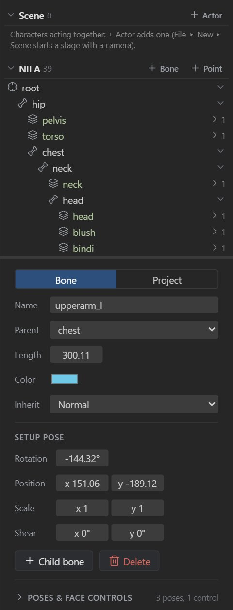
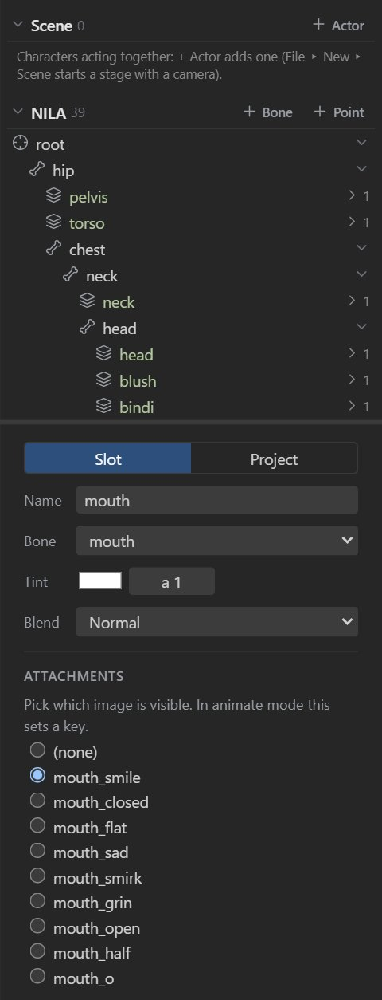

# Bones, slots and attachments

A rig has three layers: **bones** form the skeleton, **slots** sit on bones and set draw order and
color, and each slot shows one **attachment** at a time: an image, a mesh or a shape. This page covers
building them by hand. [AutoRig](autorig.md) builds the same things for you.

## Bones

### Creating bones

Bones are created in **Setup mode**:

- Pick the **Create** tool (<kbd>N</kbd>) and drag in the viewport: the bone starts where you press
  and points where you release. It becomes a child of the selected bone (the root when nothing is
  selected), and is selected itself, so the next drag continues the chain.
- **Click** without dragging to add a **point bone** there (see below).
- **+ Bone** in the tree adds a child to the selected bone, and **+ Point** a point bone at its tip.

Every project has a `root` bone at the origin. <kbd>Delete</kbd> removes the selected bone together
with its children.

### Point bones

A point bone has a length of 0: a pivot or anchor, such as a shoulder joint, a hip origin, a prop
attachment point or a common parent for several limbs.

, a shoulder and a prop anchor")

It has a position, rotation and scale like any
bone, can be the parent of regular bones and can bind mesh vertices. In the viewport it is a small
ring with a crosshair, the same size at any zoom, and a tick showing its rotation; the bone tree marks
it with ◉.

To turn a selected point bone, drag the round handle at the end of its dotted line (it works with any
transform tool), or use the Rotate tool. Setting a bone's **Length** to 0 turns it into a point bone,
and a length above 0 turns it back; children don't move, since length is visual only.

### Bone settings

| Setting | Meaning |
| --- | --- |
| **Name** | Unique name. Animations and runtimes refer to bones by name. |
| **Parent** | The bone it hangs from. Changing it keeps the bone where it is in the world. You can also drag the bone's row in the tree onto its new parent (or onto the skeleton's title for the root). |
| **Length** | Visual length, and the reach used by IK and some constraints. 0 makes a [point bone](#point-bones). |
| **Color** | The bone's color in the viewport, to tell limbs or sides apart (applies to every selected bone; **×** goes back to the default). Saved in the skeleton file, as in Spine. |
| **Inherit** | What it takes from its parent: `normal` (everything), `onlyTranslation`, `noRotationOrReflection`, `noScale` or `noScaleOrReflection`. Use `noScale` for parts that should not stretch when the parent does. |
| **Setup pose** / **Pose at current frame** | Position, rotation, scale and shear relative to the parent: the setup pose in Setup mode, the animated pose (with key buttons) in Animate mode. |

The viewport toolbar shows the same values for the active tool, in the *Local*, *Parent* or *World*
axes.

## Slots

A slot is a place in the draw order on a bone. It shows one attachment at a time, so a slot called
`mouth` can hold `mouth_smile`, `mouth_A`, `mouth_O` and the others, and an animation swaps between
them.

| Setting | Meaning |
| --- | --- |
| **Name** | Unique name. |
| **Bone** | The bone it follows. Changing it keeps the images where they are. |
| **Tint** | A color and alpha multiplied into the attachment. Animatable as color keys. |
| **Blend** | `normal`, `additive`, `multiply` or `screen`. |
| **Attachments** | Which attachment is visible: pick one, or *(none)*. In Animate mode this sets an image-swap key. |

### Draw order

Slots are drawn back to front in the **Draw order** section of the tree. Select a slot and use
*Draw in front* or *Draw behind* to move it one step, or **drag a row** to drop it anywhere in the
list. While you drag, a line marks where the slot will land and a side preview shows the slot between
the two it will sit between (the one drawn in front of it on top, the one drawn behind it below),
each with its image, so you can read the resulting stacking before releasing. The preview says
*Nothing in front* or *Nothing behind* when the slot would become the front- or back-most. At the
same time those three images glow in the viewport, each in its own colour (matching the preview, with
the dragged one brighter), so you can tell them apart in the render, not just in the tree. PSD imports
keep the layer order. Draw order can also change during an animation (draw-order keys from imported
files are kept and exported).

<figure><video src="videos/draw-order-drag.mp4" poster="videos/draw-order-drag.jpg" controls muted loop playsinline preload="none" aria-label="Dragging a slot in the Draw order list, with the side preview and the viewport glow"></video><figcaption>Dragging a slot in the Draw order list, with the side preview and the viewport glow (video by @maruccimauro)</figcaption></figure>

## Attachments

| Type | What it is | Create it with |
| --- | --- | --- |
| **Image** (region) | A bitmap placed on the slot's bone. | Import, or **Add image to this slot…** |
| **Mesh** | An image with vertices that can bend, bound to one or more bones with weights. | **Convert to mesh** on an image. See [Meshes](meshes.md). |
| **Linked mesh** | Another image sharing a mesh's shape and weights (and optionally its deform keys). | **Linked mesh with image…** on a mesh. |
| **Bounding box** | A polygon for hit testing in games. | **Add shape… ▸ Bounding box** |
| **Clipping** | A polygon that masks the slots drawn after it, up to **Clip until**. | **Add shape… ▸ Clipping** |
| **Path** | A curve other bones can follow with a [path constraint](constraints.md#path). Options: *Closed*, *Constant speed*. | **Add shape… ▸ Path** |
| **Point** | A position and rotation, for spawning effects or attaching items in a game. | **Add shape… ▸ Point** |

### Placing images

Select an image's slot in Setup mode. **Image placement** shows its image, **Position**, **Rotation**,
**Scale** and **Size** relative to the bone; **Reset size** goes back to the image's pixel size. You
can also drag the image with the Translate, Rotate and Scale tools.

> [!NOTE]
> Image placement is part of the setup pose. To move an image over time, animate its bone, or turn
> the image into a mesh and key its deformation.

### Editing shapes

For bounding boxes, clipping polygons and paths, **Edit shape** edits the vertices in the
viewport: drag vertices, click near an edge to add one, and press <kbd>Delete</kbd> to remove the
selected one. Path points have Bézier handles (<kbd>Alt</kbd>+drag moves one handle on its own).
**Finish editing** finishes.

## Image sequences

A mesh can play numbered images (`flame01`, `flame02`, …) one after another, for flipbook effects
such as fire, smoke and blinking lights. Tick **Image sequence** in Setup mode. When the image is
already one of the numbered frames (`guy-01`), the base name (`guy-`), start, digits and frame count
are read from the images you imported. Otherwise set:

| Setting | Meaning |
| --- | --- |
| **Frames** | How many images. |
| **Start** | The number of the first image. |
| **Digits** | Zero padding of the numbers (`2` gives `01`, `02`, …; `0` gives `1`, `2`, …). |
| **Setup frame** | The image shown in the setup pose. |

The panel shows the image names it expects and how many it found.

In Animate mode, the **Sequence** section keys how the sequence plays from the current frame on:

| Setting | Meaning |
| --- | --- |
| **Mode** | *Hold* (stay on **Frame**), *Once*, *Loop*, *Ping-pong*, and their *reverse* variants. |
| **Frame** | The image to show or start from. |
| **Frame time** | Seconds per image. |

## Renaming safely

Rename bones and slots in the inspector at any time: animations and constraints in the project keep
working. Game code that refers to the old name must change too.
