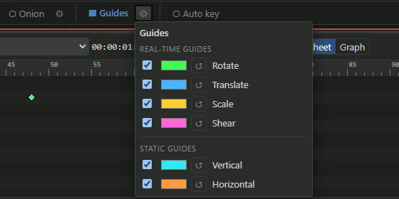

# Guides

Guides are optional viewport aids: thin overlays while you transform a bone, and Photoshop-style
rulers with guide lines to align work to. Turn them on with **▦ Guides** in the viewport toolbar;
the **⚙** button next to it opens the options. Guides are on by default.

## Options

The **⚙** popover has a row per guide type — a checkbox to enable it, a colour swatch and a reset
button — in two groups:

- **Real-time guides**: Rotate, Translate, Scale, Shear.
- **Static guides**: Vertical, Horizontal, Diagonal, Antidiagonal.

Each type keeps its own colour. Placed static guides can be cleared from the popover.

## Rulers and static guides

With guides on, horizontal and vertical pixel rulers frame the viewport.

- **Create a guide**: drag out of a ruler and drop it on the canvas.
- **Delete a guide**: drag it onto a ruler (a diagonal onto either ruler) — the ruler flashes with
  a trash icon while you hover it — or press <kbd>Delete</kbd> while dragging it.
- **Ruler corner**: click where the two rulers meet for a menu to add a main-diagonal,
  antidiagonal, vertical or horizontal guide (through the origin), or to delete the placed guides
  by type (all vertical, horizontal, diagonal, antidiagonal, or all).

<figure><video src="videos/ruler-guides.mp4" poster="videos/ruler-guides.jpg" controls muted loop playsinline preload="none" aria-label="Pixel rulers, dragging out guides, the corner menu and deleting a guide on a ruler"></video><figcaption>Pixel rulers, dragging out guides, the corner menu and deleting a guide on a ruler (video by @maruccimauro)</figcaption></figure>

## Real-time transform guides

While you drag a bone with a transform tool, a thin guide traces the change:

| Tool | Guide |
| --- | --- |
| **Rotate** | An arc from where the tip was to where it is now. |
| **Translate** | Two straight lines, from the anchor base and from the tip. |
| **Scale** | A curve at the tip. |
| **Shear** | A sphere around the anchor (see below). |

<figure><video src="videos/realtime-guides.mp4" poster="videos/realtime-guides.jpg" controls muted loop playsinline preload="none" aria-label="Real-time guides while rotating, translating, scaling and shearing bones"></video><figcaption>Real-time guides while rotating, translating, scaling and shearing bones (video by @maruccimauro)</figcaption></figure>

### Shear sphere

Shear tilts the bone's X and Y axes independently, in degrees (the X axis points along
`rotation + shear_x`, the Y axis along `rotation + 90 + shear_y`). With the **Shear** tool and a
bone selected, a sphere is drawn around the anchor; its two great circles are the X- and Y-axis
lines. Where you press picks what you change:

- on the **X-axis line** — `shear_x` (the X axis);
- on the **Y-axis line** — `shear_y` (the Y axis);
- **inside, off the lines** — free: whichever axis the cursor is nearer.

Each axis shows its tilt in degrees, counting whole turns (for example `⟳×2 20°`) and sign.
