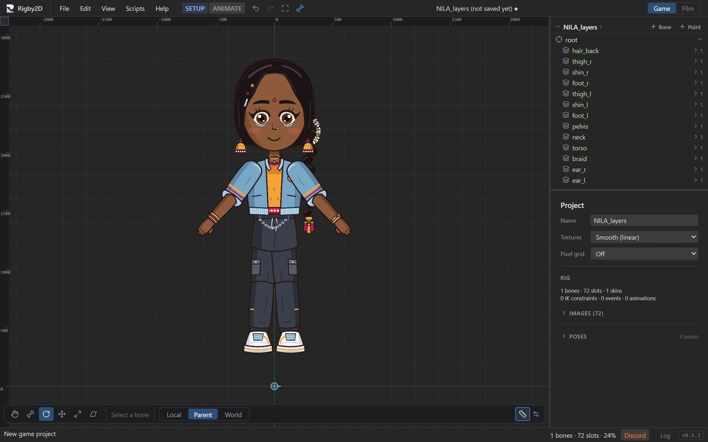

# Importing art

Rigby2D animates bitmap artwork. Draw your character in any paint program, in separate pieces that
can move on their own, and bring the pieces in as a layered PSD, an SVG with layers, or PNG files.

## Preparing artwork

- **One piece per moving part.** A head, a torso, an upper arm, a forearm, a hand. Parts that bend
  (a torso, a sleeve, a tail) can be one piece that becomes a [mesh](meshes.md).
- **Overlap the joints.** Draw a little extra where parts meet (the top of a forearm under the
  sleeve), so no gap opens when the joint rotates.
- **Draw alternates as separate layers.** Open and closed eyes, mouth shapes, hand poses. They become
  extra attachments of the same slot, swapped during animation.
- **Name the layers** after the body part and side, such as `upperarm_l` or `Hand Right`. AutoRig
  reads the names; see [naming layers](autorig.md#naming-layers).
- **Draw at the size you need.** Images are used at their pixel size. Big films can use big art; for
  games, keep the atlas small.

## Importing a PSD

*File ▸ Import ▸ PSD…* imports every pixel layer:

- Each layer becomes an image in its own slot on the root bone, exactly where it sits in the canvas.
- The canvas's bottom center becomes the origin of the world, so a character drawn standing on the
  canvas bottom stands on the ground line.
- Layer order becomes draw order (the bottom layer is drawn first, at the back).
- Groups are flattened into their layers. Hidden layers (or layers in hidden groups) are imported
  but not shown.
- Layer opacity is baked into the image.
- If the project is still untitled, it takes the PSD's file name.

Next: rig it in one step with [AutoRig](autorig.md), or by hand with
[bones](bones-and-slots.md#bones).

## Importing an SVG

*File ▸ Import ▸ SVG…* brings in a vector drawing from Inkscape, Affinity, Illustrator or any tool
that saves SVG, the same way as a PSD: every layer becomes a part, placed where it was drawn, in
drawing order, ready for [AutoRig](autorig.md).

- **Layers**: Inkscape's layers (a sublayer is a part of its own), or the groups Affinity and other
  tools export (a single group around everything is looked inside). Names come from the layer names.
- **Hidden layers** come in hidden, so spare parts (another hat, a closed hand) are there to switch on.
- **Size**: vector art stays sharp at any size, so you choose how large to draw it (50 % to 400 %
  of the drawing's own size). Pick the size the character will have in your game, or larger.
- Shapes that are in no layer come in as one more part, `background`, at the back.

Text is drawn with the fonts on your computer, and images linked from outside the file are left out
(embedded images are kept).

## Importing PNG images

*File ▸ Import ▸ PNG images…* adds one or more PNG files as images on the **selected bone** (the root
when nothing is selected).

- **Layers exported from a drawing**: when every file has the same size, as with Photoshop's *Export
  Layers to Files* or any layer export that keeps the full canvas (turn off trimming), the files are
  taken as the layers of one canvas. Each is cropped to its visible pixels and placed where it was drawn,
  exactly like a PSD, so the character arrives assembled and ready for [AutoRig](autorig.md). Order
  numbers in the file names (`07_pelvis.png`, Photoshop's `_0003_Head.png`) are dropped from the
  names, and Photoshop's numbering, which counts from the top layer, sets the drawing order.
- **Separate images** of different sizes go side by side above the bone. Move them into place with
  the Translate tool in Setup mode.

To add an image to an existing slot, for example a new mouth shape, select the slot and use
**＋ Add image to this slot…** in the inspector. See [Attachments](bones-and-slots.md#attachments).

## Texture filtering and pixel art

Select nothing to see the **Project** panel. Its **Textures** setting decides how images are drawn
when scaled:

| Setting | Use it for | Effect |
| --- | --- | --- |
| **Smooth (linear)** | Painted and vector-style art | Smooth scaling. Exported atlases use `filter: Linear, Linear`. |
| **Pixel art (nearest)** | Pixel art | Every pixel stays sharp in the viewport, in renders and in games: exported atlases use `filter: Nearest, Nearest`, which the runtimes follow. |

Opening a skeleton export picks the setting up from its atlas.

## Images in the project

The **Images** section of the tree and the Project panel list every image with its size. Images are
stored inside the `.rigby` work file, so a project is one self-contained file. Exports pack the
images that are actually used into one atlas page; see [Export](export.md).
