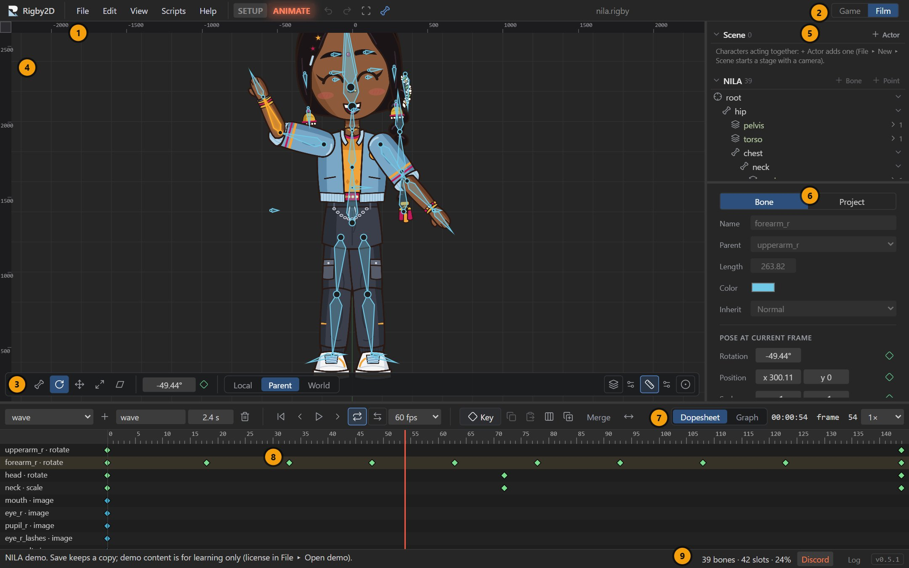

# The interface

The editor is one window with five areas around the viewport. Panels can be resized by dragging the
borders between them, and in the desktop app the Timeline, Tree and Inspector can be popped out into
their own windows.

| | Area | What it is for |
| --- | --- | --- |
| 1 | **Menu bar** | *File* (with *New*, *Open recent*, *Import* and *Export* submenus), *Edit*, *View*, *Scripts* and *Help* (see [The Help menu](#the-help-menu)), the **SETUP** and **ANIMATE** mode tabs, and buttons for *Undo*, *Redo*, *Fit the skeleton in view* and *Show or hide bones* (hover one to see its shortcut). When an update is ready, an **Update available** button appears here too. |
| 2 | **Workspace switch** | **Game** or **Film**: which tools are shown. See [Workspaces](#workspaces). |
| 3 | **Viewport toolbar** | Transform tools, the active tool's values with a key button, axes, onion skin, guides and auto key. |
| 4 | **Viewport** | The character. Select, pose and edit here. |
| 5 | **Tree** | The skeleton (bones, slots, attachments) and the draw order, skins, constraints, events, animations and images. |
| 6 | **Inspector** | Properties of the selection (a bone, slot, constraint, skin or event) and, on its **Project** tab, the project settings. Poses and face controls sit at the bottom. |
| 7 | **Timeline controls** | Animation list, **+** (new animation), length, playback, loop, speed, the time display and **Key**. |
| 8 | **Dopesheet / Graph** | Keys over time, or their curves. |
| 9 | **Status bar** | Messages, rig statistics and zoom, and the **Log** button. |

## Modes: Setup and Animate

Every edit means one of two things, chosen by the mode:

| | Setup mode | Animate mode |
| --- | --- | --- |
| Changes | The **setup pose**: the rig at rest. | **Keys** at the current frame of the current animation. |
| Bones | Create, delete, reparent, set length. | Pose them. |
| Images and meshes | Place them, edit vertices, paint weights. | Swap images, deform meshes (deform keys). |
| Mode tab | **SETUP** lit blue | **ANIMATE** glows orange |
| Timeline | Hidden, so the viewport gets the room (*View ▸ Timeline in Setup mode* keeps it) | Shown |

Switch with <kbd>Tab</kbd> or by clicking the other tab in the menu bar. The same transform tools
work in both modes; only the result differs.

## Viewport

| To | Do |
| --- | --- |
| Select a bone or image | Click it. |
| Add to or remove from the selection | <kbd>Ctrl</kbd>+click. |
| Box select | Drag in empty space (with <kbd>Ctrl</kbd> held, adds to the selection). |
| Transform the selection | Drag it with the active tool, or drag empty space while bones are selected. |
| Pan | Right or middle drag. |
| Zoom | Mouse wheel. |
| Fit the skeleton in view | The fit button in the menu bar, or *View ▸ Fit the skeleton in view* (<kbd>Ctrl</kbd>+<kbd>Shift</kbd>+<kbd>F</kbd>). |
| Deselect | <kbd>Esc</kbd>, or click empty space. |

Hovering a bone — in the viewport, the tree or a timeline track — highlights it in all three at
once with a short glow, so you can tell which bone is which across the panels (and across detached
panel windows). The selection is shown the same way.

<figure><video src="videos/bone-highlight.mp4" poster="videos/bone-highlight.jpg" controls muted loop playsinline preload="none" aria-label="Hovering a bone highlights it in the viewport, the tree and the timeline at once"></video><figcaption>Hovering a bone highlights it in the viewport, the tree and the timeline at once (video by @maruccimauro)</figcaption></figure>

### Tools

| Tool | Key | Does |
| --- | --- | --- |
| **Pose** | <kbd>B</kbd> | Drag a bone to aim it at the cursor; drag near its origin to move it. The quickest way to pose. |
| **Create** | <kbd>N</kbd> | Drag to draw a bone (Setup mode). Select a bone first to chain the new one from it. |
| **Rotate** | <kbd>C</kbd> | Rotates the selection. |
| **Translate** | <kbd>V</kbd> | Moves the selection. Hold <kbd>Shift</kbd> while dragging to move along one axis only. |
| **Scale** | <kbd>X</kbd> | Scales the selection. |
| **Shear** | <kbd>Z</kbd> | Shears the selection. |

Keys are those of the default *Spine-like* preset; a *Blender-like* preset is under *View*. See
[Keyboard shortcuts](shortcuts.md).

Next to the tools, the active tool's values for the selected bone can be dragged or typed. In
Animate mode a **◆** button keys them; its color says whether the value is keyed at this frame,
changed but not keyed, or not keyed.

**Axes**: *Local*, *Parent* and *World* decide the space the values are shown in and the
direction the Translate tool moves.

**Guides**: optional real-time transform guides and Photoshop-style ruler guides; see
[Guides](guides.md).

### View options

The *View* menu chooses what is drawn over the art:

- *Show bones*, *Show clipping masks*, *Show bounding boxes*, *Show paths* and *Show points*, one
  switch per kind (remembered between sessions). A shape you select stays visible even when its kind
  is hidden, so you can still edit it. The bone button in the menu bar and <kbd>Ctrl</kbd>+<kbd>Shift</kbd>+<kbd>B</kbd>
  also show or hide bones.
- *Show output frame* (Film workspace).
- **Hide overlays** (<kbd>Ctrl</kbd>+<kbd>Shift</kbd>+<kbd>H</kbd>, or <kbd>Shift</kbd>+<kbd>Alt</kbd>+<kbd>Z</kbd>
  with the Blender-like shortcuts) hides bones, shapes, selection outlines and guides at once, to
  watch the animation as it renders. Press it again to bring them back.
- *Timeline in Setup mode* keeps the timeline on screen in Setup mode.

It also has the **Log** window, *Window layouts* (desktop app) and zoom commands. The viewport
renderer and the shortcut preset are in [Preferences](preferences.md) (*Interface*).

## Tree

The tree has collapsible sections:

- **Skeleton**: bones in their hierarchy, each with its slots. A slot shows its visible attachment
  next to its name; click **▸** (with the number of attachments) to list them all, and click one to
  show it (in Animate mode, that sets an image-swap key). **+ Bone** adds a child to the selected
  bone, as long as its parent, and **+ Point** a [point bone](bones-and-slots.md#point-bones) at its
  tip. The **Find** box at the top shows only the bones and slots whose names contain what you type
  (with the bones above them), and Esc clears it. In Setup mode, drag a bone's row onto another bone
  to make that its parent, or onto the skeleton's title for the root; the bone keeps its place.
- **Draw order**: slots back to front; *Draw in front* and *Draw behind* move the selected slot, or
  drag a row to drop it anywhere (a side preview shows its image between its new neighbours as you
  drag). See [Draw order](bones-and-slots.md#draw-order).
- **Skins**, **Constraints** and **Events**: with **+** buttons to create them. See
  [Skins and events](skins-and-events.md) and [Constraints](constraints.md).
- **Animations** and **Images**.

Bones also have an onion-skin button that limits onion skinning to that bone and its children.
See [Onion skin](onion-skin.md).

## Inspector

The inspector shows what is selected:

- **Nothing**: the **Project**: name, texture filtering (smooth or pixel art), the
  [pixel grid](importing-art.md#pixel-grid), the **Output** section in the Film workspace, rig
  statistics, images and audio tracks. With something selected, the same settings are on the
  inspector's **Project** tab (the selection stays; selecting something else goes back to it).
- **A bone**: name, parent, length, inheritance, and its pose at the current frame.
- **A slot**: its attachments, color and blending, and the selected attachment's settings.
- **A constraint, skin or event**: every setting of it.

At the bottom, **Poses & face controls** is always there. See [Poses and face controls](poses-and-faces.md).

## Timeline

The timeline row holds the animation menu, **+** (new animation), the animation's name and **Length**, a delete
button, playback (start, previous frame, play, next frame), **Loop**, **Boomerang**, playback speed,
the project's **frame rate**, **Key**, the key tools, **Dopesheet** and **Graph** (which switch
the view below), and last the time: frame and seconds, or timecode and frame in the Film workspace.
On a narrow window the timeline row and the viewport toolbar keep every button but hide their labels;
hover a button for its name and shortcut.
See [Animating](animating.md) and [Graph editor](graph-editor.md).

## Workspaces

| | Game | Film |
| --- | --- | --- |
| For | Game engines and apps | Film, video, motion graphics |
| Output | Skeleton JSON / `.skel` + atlas | PNG sequences, WebM, MP4 (exports stay available) |
| New projects | 30 fps | 24 fps |
| Time display | Frames and seconds | Timecode `MM:SS:FF` and frames (hours appear past one hour) |
| Output settings, output frame, *Render animation* | Hidden | Shown |
| Audio tracks, lip-sync, face controls | Hidden | Shown |

The workspace is saved in the `.rigby` file. Switching is always safe: film settings, poses and face
controls never reach skeleton exports.

## Log

*View ▸ Log* (or **Log** at the right of the status bar) lists status messages, script output,
warnings and errors with expandable tracebacks. Filter by level or text, and **Copy** entries for a
bug report. The status bar button turns red and counts errors you have not seen yet.

## Detached panels and window layouts

In the desktop app, the Timeline, Tree and Inspector can each be popped out into a window of its own,
for example on a second monitor. Everything stays in sync with the main window.

*View ▸ Window layouts* saves where the panels sit as a named layout:

- **Save current layout…** stores which panels are popped out and where.
- **Manage layouts…** renames, updates and deletes layouts, and binds a shortcut
  (<kbd>Ctrl</kbd>+<kbd>Alt</kbd>+<kbd>1</kbd> to <kbd>9</kbd>) that recalls a layout from any
  Rigby2D window.

## The Help menu

| Item | What it does |
| --- | --- |
| *What's new in 0.5…* | A short tour of this release. |
| *Welcome screen…* | New projects, recent work, demos and lessons. |
| *Tutorials…*, *Keyboard shortcuts…* | Interactive lessons, and every shortcut with a search. |
| *Documentation* | These pages. |
| *Connect an AI assistant…* | Sets up the [MCP server](mcp.md) for an AI assistant. |
| *Community ▸* | *Discord* (the community), the *Devlog* (release news) and this version's *Release notes*. |
| *Report a problem ▸* | *Report an issue* on GitHub, or *Report a crash…*: a report of recent errors to copy or post. |
| *Support Rigby2D…* | The monthly goal, the Founding Supporters, everyone who funds Rigby2D and the code contributors, with a link to sponsor. |
| *Check for updates…* | Desktop app: looks for a new version now (it also checks at startup). |
| *About Rigby2D* | Version, licenses and credits. |
