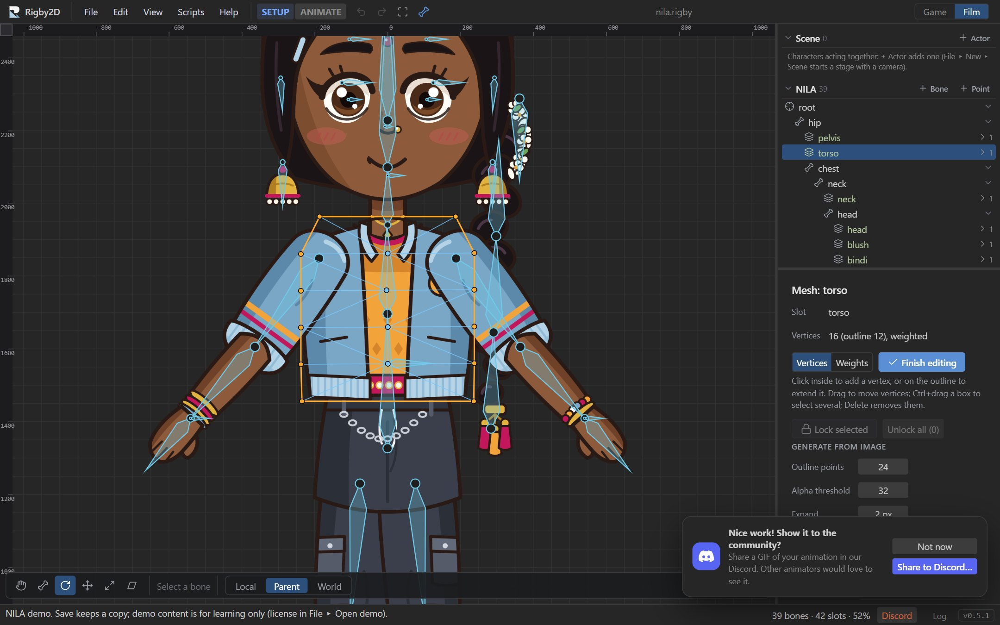
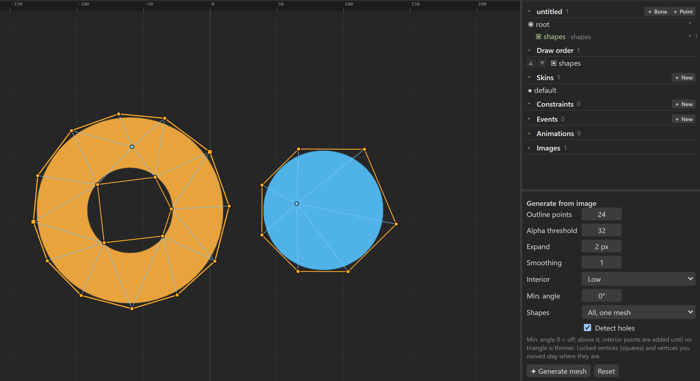
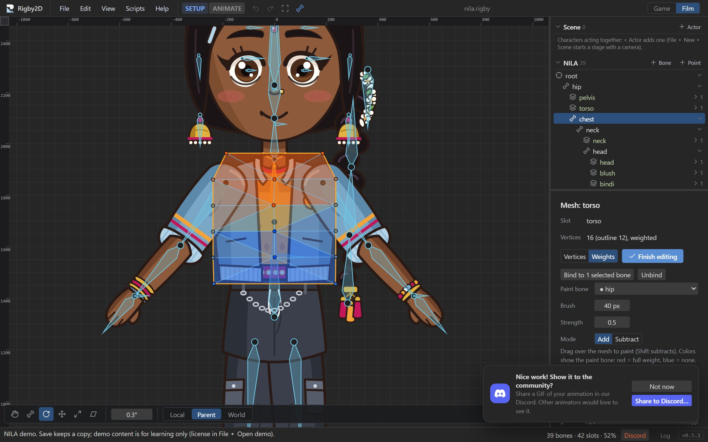

# Meshes

A mesh is an image with vertices. Meshes bend: bind one to several bones and each vertex follows them
by its weights, so a sleeve bends at the elbow, a torso twists and a tail curls. In Animate mode, you
can also move vertices directly and key the shape (deform keys).

## Turning an image into a mesh

1. In Setup mode, select the image's slot.
2. Press **Convert to mesh** in the inspector. The image is replaced by a mesh with four vertices
   at its corners, and mesh editing starts.
3. Click to add vertices: around the visible shape of the image to outline it, and inside where it
   should bend. **Edit mesh** edits it again later.

AutoRig makes meshes for bending parts by itself.

## Generating a mesh from the image

Instead of clicking every vertex, let Rigby2D trace the image. While editing a mesh in Setup mode,
set the options under **Generate from image** in the mesh panel and press **✦ Generate mesh**:

| Option | What it does |
| --- | --- |
| Outline points | Exactly how many vertices the outline gets (holes and other shapes share them, by length). Fewer for props, more where the art bends. |
| Alpha threshold | How opaque a pixel must be (1 to 254) to count as part of the shape. |
| Expand | Grows (or, negative, shrinks) the shape by whole pixels before tracing, to leave a margin. |
| Smoothing | Rounds off pixel steps in the outline before it is simplified. |
| Interior | Adds evenly spaced inner vertices (None, Low, Medium, High) so the mesh bends smoothly. |
| Min. angle | 0 is off. Above it, inner vertices are added until no triangle has a smaller angle, so weights are easier to tune around bends. The outline keeps its exact points. |
| Shapes | When the image has separate shapes: **Largest only**, **All, one mesh** (every shape in this mesh) or **All, one mesh each** (every other shape becomes a mesh of its own, in a new slot just above this one). |
| Detect holes | Traces inner contours too, so transparent holes (a ring, a handle) are left out of the mesh. |

The outline always contains every pixel above the threshold: when it uses few points, its edges are
pushed out so they never cut into the art. After the first generate, changing an option regenerates
the mesh right away, so you can watch the vertex count change. The status bar shows the vertex and
triangle counts. A weighted mesh keeps its bones: the new vertices take the weights of the old mesh
where they are. The settings are remembered, so the next part can use the same ones, and **Reset**
returns to the defaults. Tiny specks of stray pixels are ignored.

With **All, one mesh each**, generating again replaces the meshes it made before instead of adding
more. A mesh with holes or several shapes keeps every outline as an edge (Spine's mesh edges), so
adding, moving or deleting vertices later never fills the holes in.

### Keeping vertices you placed

Vertices you **lock** stay exactly where they are when the mesh is generated again (position,
texture and weights); only the rest is recomputed, and **Outline points** counts the rest. Select
vertices and press **Lock selected** (again to unlock), or **Unlock all**. Moving a vertex by hand
locks it too, so tweaking first and changing an option afterwards is safe. Locked vertices are drawn
as squares; a locked outline vertex joins the nearest outline. Locks are saved in the `.rigby` file
and never exported.

## Editing vertices

With **Vertices** selected in the mesh panel:

| To | Do |
| --- | --- |
| Add a vertex inside | Click inside the mesh. |
| Extend the outline | Click near or outside the outline. |
| Move vertices | Drag them over the image. |
| Select several | <kbd>Ctrl</kbd>+click, or <kbd>Ctrl</kbd>+drag a box. |
| Delete | Select and press <kbd>Delete</kbd>. |

The mesh panel shows the vertex count (outline and inner) and whether it is weighted. Rigby2D
triangulates the mesh for you. Put vertices where the image should bend: rows across a joint bend
smoothly, and few vertices elsewhere keep the mesh light.

**Finish editing** finishes editing.

## Weights

A weighted mesh follows several bones. Each vertex has a weight per bone, and the weights of a vertex
add up to 1.

1. Select the bones the mesh should follow: <kbd>Ctrl</kbd>+click them in the tree.
2. Press **Bind to N selected bones**. Each vertex is weighted to the nearest of those bones.
3. Switch to **Weights** to refine them by painting.

| Setting | Meaning |
| --- | --- |
| **Paint bone** | The bone you are painting weight for. ● marks bones the mesh uses. |
| **Brush** | Brush radius in pixels. |
| **Strength** | How much one stroke changes the weight. |
| **Mode** | *Add* or *Subtract* (hold <kbd>Shift</kbd> to subtract while painting). |

Drag over the mesh to paint. Colors show the paint bone's weight: red is full weight, blue none.
**Unbind** removes the weights; the mesh then follows its slot's bone only.

### Testing weights while you paint

You don't need a test animation to see what the weights do. While painting:

- **Alt+drag a bone** to try a pose: near the bone's start it moves the bone, elsewhere on it the bone
  turns toward the cursor. The mesh bends exactly as it will in animation, and the brush and colors
  follow the posed mesh, so you can keep painting on it. Bones moved by IK follow their target:
  Alt+drag the target.
- **Wiggle** swings the paint bone back and forth (by the angle next to it) while you paint, so every
  stroke shows its effect at once. For a bone in an IK chain it swings the chain's target.
- **Reset** puts every bone back. The setup pose never changes: the test pose is for looking only, is
  not saved, and ends when you leave weight painting.

> [!TIP]
> A crease at a joint means the weights change too suddenly across it: wiggle the bone and paint a
> softer blend over two or three rows of vertices.

## Deforming in Animate mode

In Animate mode, **Deform mesh** lets you move vertices over time:

- Drag vertices to key their positions at the current frame; drag a box (or <kbd>Ctrl</kbd>+click)
  to select several and move them together.
- Keys appear in the dopesheet as the slot's **deform** row.

Deform keys add to what the bones do, so you can squash a face for a blink, bulge a cheek or wobble a
belly on top of the skeletal animation.

## Linked meshes

A linked mesh shows another image with the same vertices, triangles and weights as a mesh. Use it for
alternate drawings of a bending part, such as a sleeve in another color for a different outfit.

On a mesh, choose an image in **Linked mesh with image…**. *Use the deform keys of the parent mesh*
decides whether it also follows the mesh's deform keys. Edit the parent mesh; the linked ones follow.

## Image sequences on meshes

Meshes can play numbered image sequences. See [Image sequences](bones-and-slots.md#image-sequences).
