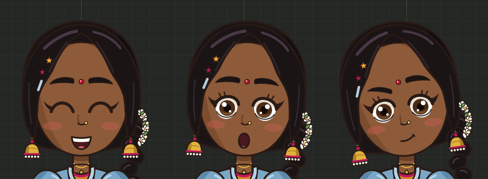
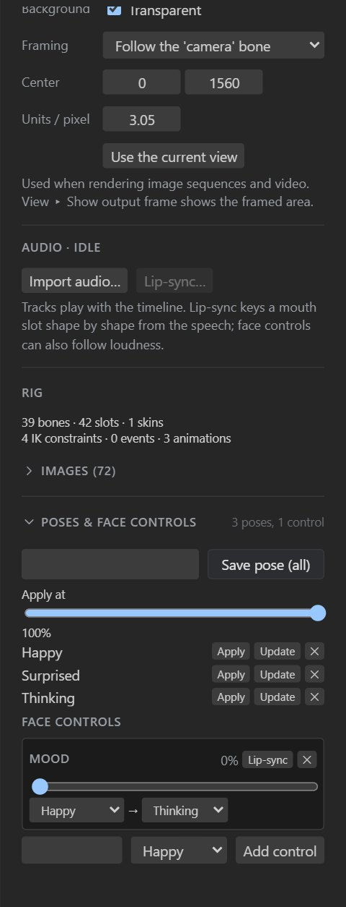

# Poses and face controls

The **pose library** stores poses you reuse: expressions, hand shapes, mouth shapes, a character's
idle stance. **Face controls** are sliders that blend between poses, so a single slider takes a face
from happy to thinking. Both live at the bottom of the inspector, in **Poses & face controls**.

## The pose library

### Saving a pose

1. Pose the character. Select the bones the pose is about (for a face: the head, brows, eyes,
   pupils and mouth), or select nothing to save every bone.
2. Type a name and press **Save pose** (**Save pose (all)** with nothing selected).

A pose stores the bones' transforms **and the images their slots show**, so mouth shapes, eyes
closed or open, and hand drawings are part of it.

### Using a pose

| Button | Does |
| --- | --- |
| **Apply** | Puts the pose on the rig, at the **Apply at** amount (0 to 100%). In Setup mode it changes the setup pose; in Animate mode it sets keys at the current frame. |
| **Update** | Replaces the pose with the current pose of the same bones. |
| **✕** | Deletes the pose. |

Applying at less than 100% blends from the current pose toward the saved one: a half smile, a
slight lean.

## Face controls

Face controls are sliders (in the Film workspace) that blend from one pose to another. Use them to
build a face rig: *Brows up*, *Eyes closed*, *Mouth open*, or a *Mood* slider from happy to thinking.

### Adding a control

Save the poses first. Then, under **Face controls**, type a name, choose the pose it blends to, and
press **Add control**. A control blends from the setup pose to its pose; choose a **from** pose to
blend between two poses instead (NILA's *Mood* goes from *Happy* to *Thinking*).

### Using a control

- In **Setup mode**, dragging the slider blends the setup pose.
- In **Animate mode**, dragging the slider keys the blend at the current frame.

Rotations take the short way round, and image swaps switch at the halfway point, so eyes close and
mouths change cleanly in the middle of a blend.

### Lip-sync from loudness

Each control has a **Lip-sync** button: it keys the control on every frame from the loudness of the
animation's first audio track. A *Mouth open* control then opens on speech and closes in silence.
For mouth shapes per sound, use [viseme lip-sync](lip-sync.md) instead.

## 2.5D turn

A head (or a body) can turn left and right, and tilt up and down, as if it were 3D, with one control. Select the bone the
parts hang from (the head) and, in the inspector's **2.5D turn** section, press **Make turnable**.
Every picture on that bone and the bones below it turns together:

- Each part gets a **depth** from the draw order: front hair and the nose near, the face in the
  middle, ears and back hair far. Near parts move more when the head turns; parts behind move the
  other way.
- The parts sit on a **curved surface** across their width, so the side turning away foreshortens
  and the side turning in widens.
- Image parts become grid meshes, so they can bend.

Drag the new **control bone** (`head-turn-control`, placed above the head): left and right turns the
head, up and down tilts it, and diagonally does both. Or use the **Turn** and **Tilt** sliders in the
section (double-click one for straight ahead). In Animate mode the sliders key the control bone; key
it like any bone to make a character look around.

| Setting | Meaning |
| --- | --- |
| **Angle** | The largest turn, at the control's full reach (20° by default). |
| **Tilt angle** | The largest tilt up or down (12° by default). |
| **Roundness** | How curved the surface is: 0 flat (parts only slide), 1 a full cylinder. |
| **Depth of each part** | How near each part is: higher moves more. |

**Rebuild** measures the parts again after you change the pictures or bones; **Remove** takes the
turn out (the meshes stay). Changing the angle, roundness or a depth rebuilds it at once, and keys on
the control bone are kept.

The turn is ordinary skeleton data, so every runtime plays it: two animations of mesh deform keys
(`head-turn`, left to right, and `head-turn-tilt`, down to up) and two additive slider constraints
that play them from the control bone's x and y. Additive means turn and tilt combine, and they add to
any other mesh animation on those parts. In a game, move the control bone to make the character look
at something: the player, the cursor, whoever is talking.

## Poses in exports

Poses and face controls are editing tools: they are saved in the `.rigby` file but not in skeleton
exports. What they produce (keys and image swaps) is ordinary animation data, so it exports and plays
in every runtime.

## Through MCP

`save_pose`, `apply_pose`, `delete_pose`, `add_face_control`, `set_face_control` and
`delete_face_control` work on `.rigby` files. See the [MCP tools](mcp-tools.md).
