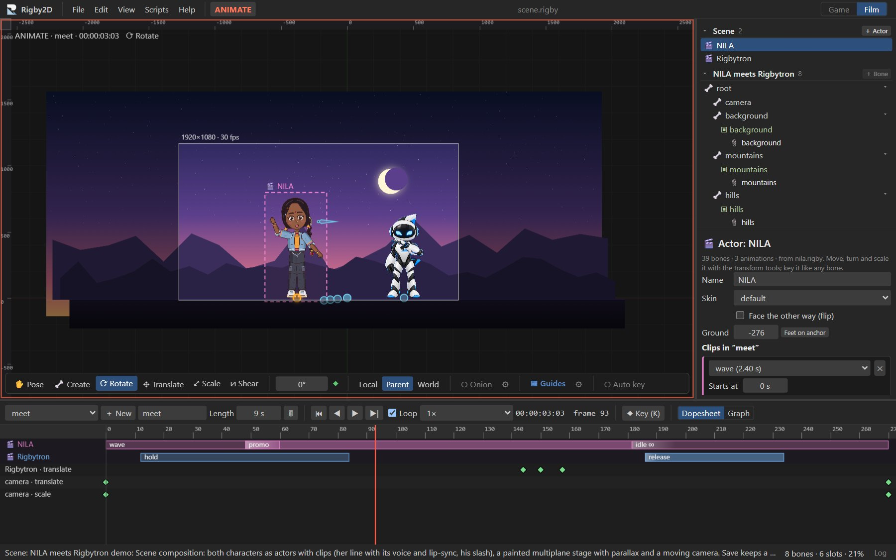
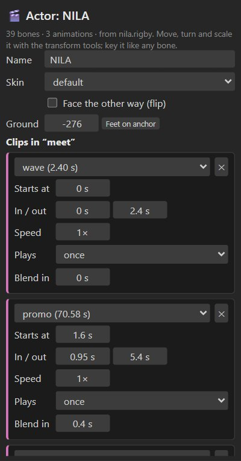
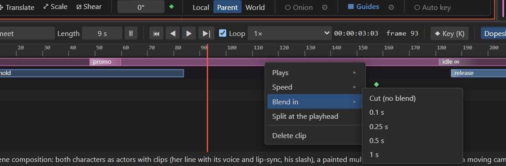
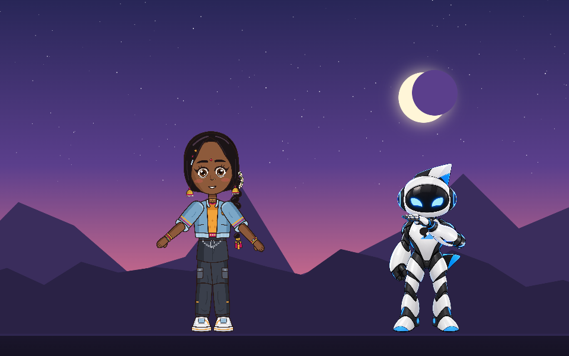

# Scenes

A scene puts several characters on one stage: each **actor** plays clips of its own animations on a
shared timeline, NLE-style, in front of painted layers with **parallax**, filmed by a **camera** you
animate. Scenes are part of the Film workspace and render to PNG sequences, WebM and MP4 with every
actor's audio.

<figure><video src="videos/scene-demo.mp4" poster="videos/scene-demo.jpg" controls playsinline preload="none" aria-label="The scene demo rendered to MP4"></video><figcaption>The scene demo (File ▸ Open demo ▸ Scene: NILA meets Rigbytron), rendered to MP4 by Rigby2D. Sound on: NILA's line comes from her own clip, with its lip-sync; then Rigbytron hops and says hi in his robot voice (an audio track of the shot).</figcaption></figure>

## How a scene works

A scene is an ordinary project used as a **stage**, so every tool you already know works on it:

| Part | What it is |
| --- | --- |
| **Stage** | The scene's own skeleton. Backgrounds and props are images on its bones; its animations are the **shots**. |
| **Camera** | The stage's `camera` bone. The output frame follows it: key its position to pan and its scale to zoom. |
| **Layers** | Top-level stage bones. Give one a **depth** and it drifts behind nearer layers as the camera moves (parallax), keeping the size it was drawn at. |
| **Actors** | Characters (other `.rigby` projects) placed on the stage. Each stands on an **anchor bone** (move, turn, scale and flip it with the usual tools, and key it like any bone) and is drawn at its **slot** in the draw order. |
| **Clips** | An actor's animations placed on a shot: start, trim, speed, loops and a crossfade from the clip before. Physics, mesh deformation, face swaps and lip-sync all play inside the actor. |



## Making a scene

1. **File ▸ New scene (several characters)** starts a Film project set up as a stage: a `camera`
   bone the output frame follows, a `background` layer with depth, and a first shot (`shot 1`, 5 s).
2. **Add characters**: in the tree's **Scene** section, press **＋ Actor** and choose a `.rigby`
   file or one of the demos. The character is copied into the scene, so the scene file is complete on
   its own. It is placed at the center of the view with a first clip at the playhead.
3. **Add backgrounds**: select a layer bone (such as `background`) and use *File ▸ Import PNG
   images…*; or add your own layer bones (children of the root) for mountains, trees and
   foreground props.
4. **Stage it**: click an actor in the viewport to select it (a dashed frame shows which), then move,
   turn and scale it with the transform tools. Actors stand with their feet on their anchor, so
   keeping anchors at y = 0 keeps everyone on the ground. In Animate mode, key it like any bone to walk it across
   the stage.
5. **Direct it**: give each actor its clips (below), key the camera, and play with <kbd>Space</kbd>.
6. **Render**: *File ▸ Render animation…* renders the shot with every actor, layer and sound.

## Actors

Select an actor (click it in the viewport, or its row in the tree's **Scene** section) to see the
**Actor** panel above the bone settings:



| Setting | Meaning |
| --- | --- |
| **Name** | The actor's name in the scene. |
| **Skin** | Which of the character's skins it wears. |
| **Face the other way (flip)** | Mirrors the actor, so two characters can face each other. |
| **Ground** | Raises or lowers the character so its feet stand on the anchor bone. Characters are often drawn with their feet above or below their origin; when an actor is added, Rigby2D measures where its feet are (the lowest point of its setup pose) and sets this for you, so every actor stands on the same ground line at any size. **Feet on anchor** measures it again. |
| **Clips in "shot"** | Its clips in the current shot (below). **＋ Add clip at the playhead…** adds one. |
| **🗑 Remove actor** | Takes it off the stage with its anchor bone and slot. |

The actor's anchor bone and slot are ordinary stage bones and slots, which gives you more for free:

- **Draw order**: an actor is drawn where its slot sits among the stage's slots. Reorder it in the
  tree's Draw order section, or key the draw order so actors pass in front of each other.
- **Fades and tints**: the slot's tint colors the whole actor; key its alpha to fade an actor in or
  out.
- **Movement**: key the anchor bone's position, rotation and scale. Onion skin and the graph editor
  work on it as usual.

## Clips

Each actor has a lane at the top of the dopesheet with its clips as bars: the name of the animation,
its speed (`2×`), its loops (`×2`, `∞`), the crossfade from the clip before (a light wedge at its
start) and loop boundaries (thin lines).

| In the lane | Does |
| --- | --- |
| Drag a clip | Move it in time. |
| Drag its left edge | Trim the start: the clip starts later and skips the same part of the animation. |
| Drag its right edge | Trim the end. |
| Right-click a clip | **Plays** once, 2 or 3 times, or loops until the next clip; **Speed** 0.25× to 2×; **Blend in** (crossfade from the clip before, or a cut); **Split at the playhead**; **Delete clip**. |
| Right-click an empty part of a lane | Add a clip of any of the actor's animations there. |



The Actor panel shows the same clips with exact values:

| Field | Meaning |
| --- | --- |
| **Starts at** | When the clip starts on the shot, in seconds. |
| **In / out** | Which part of the animation it plays. |
| **Speed** | Playback speed. |
| **Plays** | Once, several times, or *loops until the next clip*. |
| **Blend in** | Crossfade from the previous clip, in seconds (0 = cut). |

Between clips, the actor holds the last frame of the clip before; before its first clip it stands in
its setup pose. The shot grows to fit clips that end after it.

> [!TIP]
> A long animation can be cut into shots with **In / out**: NILA's 70-second promo is one animation,
> and the demo plays four seconds of it, her "Hi! I'm Nila, and I'm made of layers.", as one clip.

## Audio from clips

An actor's animations keep their audio tracks: when a clip plays an animation that has audio, the
scene plays that audio from the clip's in point, cut where the clip ends. Dialogue recorded on a
character, with its lip-sync, comes along with the clip into every scene. Clips at another speed
than 1× stay silent. The stage's own audio tracks (music, ambience) play as usual, and renders mix
everything.

## Layers and parallax

Select a top-level stage bone and set its **Depth** in the bone panel:

| Depth | Effect when the camera moves |
| --- | --- |
| `0` | Moves with the stage (like the actors' ground). |
| Positive (`500`, `1500`, `4000`) | Drifts behind: a layer at depth *z* keeps up with 1000 / (1000 + *z*) of the camera's motion. Far skies barely move; hills move a little. |
| Negative | In front of the stage: moves faster, for foreground props sweeping past. |

Layers keep the size they were drawn at (like "maintain size" in other tools), so you paint each
layer as it should look and set its depth separately. Actors standing on a bone with depth move
with that layer.

## Camera

The stage's `camera` bone frames the output (Project ▸ Output ▸ **Framing: Follow the 'camera'
bone**, set up by New scene). Key its translation to pan, and its scale to zoom (scale 2 shows half
as much). *View ▸ Show output frame* shows what renders.

## Saving

A scene saves as one `.rigby` file containing the stage, its images and sounds, and every actor's
character (stored under `actors/` inside it), so it opens anywhere. Each actor keeps its character
exactly as it was added; to update a character, remove the actor and add the new version.

Skeleton exports (*Export JSON / .skel*) contain the stage only; to play a whole scene in a game,
use *Export scene for runtimes* (see [In games and apps](#in-games-and-apps)).

## Performance

Actors are drawn by the same batched WebGL renderer as everything else, and each actor's pose is
computed once per frame. On a desktop PC, the demo scene (two characters, four painted layers)
plays at the display's refresh rate in the editor and renders 8 seconds of 720p MP4 with audio in
about 3 seconds.

## In games and apps

Scenes play in games as cutscenes, intros or living backgrounds, with the camera, parallax, clips
and crossfades exactly as in the editor. *File ▸ Export scene for runtimes…* writes:

| File | What it is |
| --- | --- |
| `name.scene.json` | The scene: actors, their anchor bones and slots, clips per shot, ground offsets, layer depths. |
| `name.json` + `.atlas` + `.png` | The stage as a skeleton export (backgrounds, camera, anchor bones, shots). |
| `name.<actor>.json` + `.atlas` + `.png` | Each character, as a skeleton export. |

Every runtime plays it and matches the editor frame by frame: the [Rust runtime](runtimes.md#rust)
is checked against the JavaScript one on the demo scene, physics included.

**Godot**: add a `RigbyScene2D` node and set *Scene File*. Follow the stage's camera with a
`Camera2D`:

```gdscript
func _process(_delta: float) -> void:
	$Camera2D.position = $Scene.get_camera_transform().origin
```



**JavaScript**:

```js
import { loadScene, readSkeletonJson } from './core/index.js';

const player = await loadScene(manifest, async (file) => readSkeletonJson(await (await fetch(file)).json()).skeleton);
player.play('meet', true);

function frame(dt) {
  player.update(dt);
  // Draw the stage in its draw order; at each actor's slot, draw that actor tinted by the slot.
  renderer.drawSkeleton(player.stage, player.pose, stageTextures, {
    between: (slot) => {
      const actor = player.scene.actors.find((a) => a.slot === player.stage.slots[slot].name);
      if (actor) renderer.drawSkeleton(player.actorDocs.get(actor.id), player.actorPoses.get(actor.id), textures[actor.id]);
    },
  });
}
```

**Rust**: `rigby_runtime::scene::load_scene` returns a `ScenePlayer`; `draw_list()` gives the
stage slots and actors back to front, and `RenderOutput::append` layers their geometry.

## Through MCP

An AI assistant can build and direct scenes in `.rigby` files:

| Tool | Does |
| --- | --- |
| `add_actor` | Puts a character (another `.rigby` file) on the stage with its feet on the ground line, placed, scaled and flipped, with an optional first clip. |
| `add_clip` / `remove_clip` | Places or removes clips: start, in / out, speed, loops and blend. |
| `set_actor` | Moves, scales, flips, reskins or renames an actor. |
| `set_layer_depth` | Sets a layer's parallax depth (and the scene's focal distance). |

`inspect_project` describes the scene. See the [MCP tool reference](mcp-tools.md).
