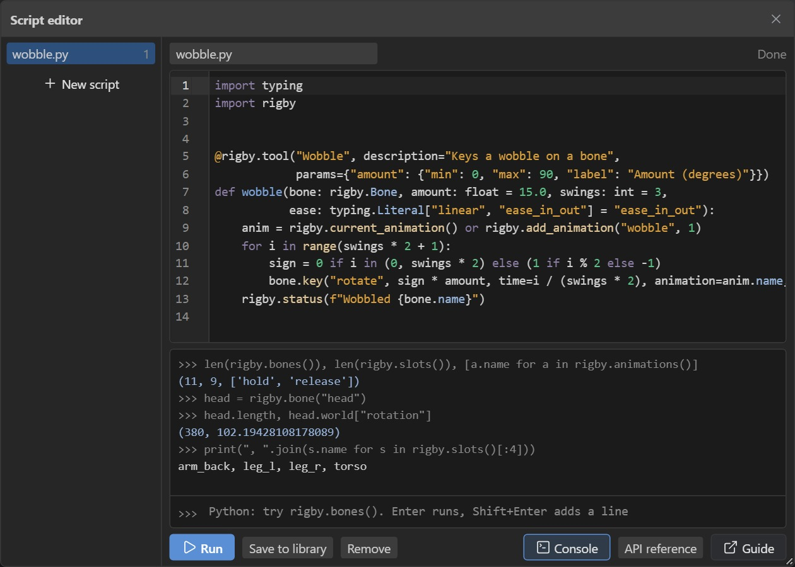
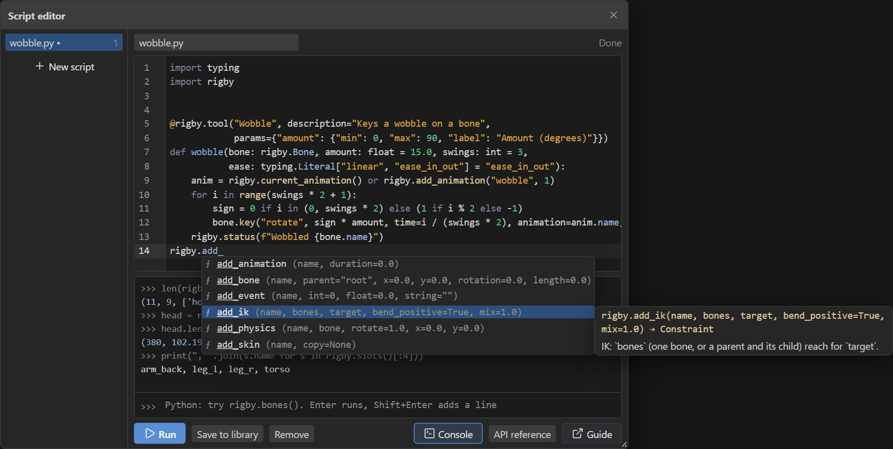
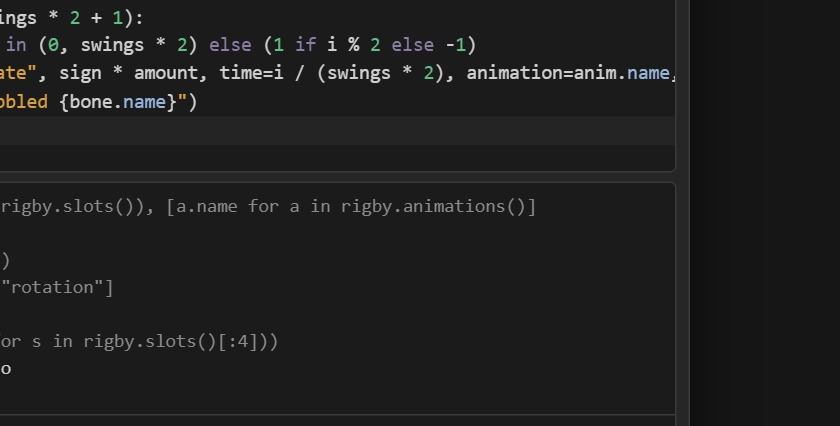

# Python scripting

Rigby2D runs Python scripts inside the editor. Use them to automate rigging and animation chores,
or to build **custom tools**: functions that appear in the **Scripts** menu for you and your team.

Python is built in (CPython 3.14 on [Pyodide](https://pyodide.org), bundled with the editor), so
there is nothing to install. Scripts work offline and on every platform.

**Scripts run sandboxed.** Python runs in a separate worker with a copy of your project: a script
can read and change the open project, but it can't reach the rest of the editor, your files or the
network. When it finishes, its changes come back as one undo step. To share tools with others,
package them as an [add-on](addons.md).

## Quick start

1. *Scripts ▸ Script editor…* opens the script editor with an example.
2. Press **▶ Run** (Ctrl+Enter). Output from `print` goes to the log (*View ▸ Log*).
3. Press **Save to library** to keep the script: it loads every time the editor starts, and the
   tools it defines stay in the **Scripts** menu.

```python
import rigby

@rigby.tool("Mirror selected bones", description="Flip the selected bones across X = 0")
def mirror():
    for bone in rigby.selected_bones():
        bone.set(x=-bone.x, rotation=180 - bone.rotation)
```

After you run or save this script, *Scripts ▸ Mirror selected bones* runs `mirror()`.



### The code editor

The code area colors Python as you type, numbers the lines and indents for you (four spaces; Tab
and Shift+Tab indent and outdent). Ctrl+F searches, and Ctrl+Z undoes your typing.

- **Completion** lists the `rigby` API as you type `rigby.`, with each function's arguments and a
  short description. Once the script has given a name a type (`b = rigby.bone("arm")`, a
  `for s in rigby.slots():` loop, a parameter `bone: rigby.Bone`), `b.` lists that type's members.
  Inside a string it offers the open project's names: `rigby.bone("` lists your bones, and
  `animation="` your animations. Ctrl+Space asks for it at any time.
- **When a run fails**, the line it failed on is marked in red with the error. Edit the code and
  the mark goes. The full traceback is in the log.



### The console

The **Console** button in the script editor opens a Python prompt on the open project, below the
code. It stays open the next time you open the script editor, until you close it again. Type a line and press **Enter**: an expression shows its value, `print` output
appears below it, and errors show in red. Shift+Enter adds a line, and a line ending in `:` goes on
to the next one, for loops and functions. Up and Down bring back earlier lines.

```
>>> arm = rigby.bone("arm")
>>> arm.length
80
>>> for b in rigby.selected_bones(): b.rotation += 10
```

Names you define stay until Python restarts, and completion knows them. Each line that changes the
project is one undo step.

### Scripts in files

*Scripts ▸ Add script files (.py)…* adds scripts from disk. In the desktop app the editor remembers
where each file came from: edit it in your own code editor, then choose *Scripts ▸ Reload scripts*.
In the browser version the script's text is stored with the editor instead.

## Undo, errors and the log

- A script run, or one run of a tool, is **one undo step** (Ctrl+Z puts everything back).
- If a script raises an exception, the project is left **exactly as it was**. The status bar shows
  the error, and the log shows the full traceback, trimmed to your script's own lines.
- The **Log** window (*View ▸ Log*, or the **Log** button at the right of the status bar) lists
  status messages, script output, warnings and errors, with tracebacks you can expand. Filter by
  level or text, and use **Copy** to paste entries into a bug report. The status bar button turns
  red and counts errors you have not seen yet.

```
Traceback (most recent call last):
  File "broken.py", line 6, in <module>
    find_leg()
  File "broken.py", line 4, in find_leg
    return rigby.bone("leg")
rigby.RigbyError: No bone 'leg'
```

## API reference

Everything lives in the `rigby` module. Bones, slots, animations, skins, events and constraints
are found by name, and every function that takes one accepts its name or the object. Angles are in
degrees and times in seconds. In the script editor, completion shows all of this as you type.

### Project

| Function | Returns |
| --- | --- |
| `rigby.info()` | `dict`: `path`, `workspace` (`'game'` or `'film'`), `fps`, `mode`, `time`, `animation`, `skin` |
| `rigby.fps()` | Frame rate of the project |
| `rigby.mode()` / `rigby.set_mode('setup' \| 'animate')` | Editor mode |
| `rigby.time()` / `rigby.set_time(seconds)` | Current time on the timeline |

### Bones

| Function | Returns |
| --- | --- |
| `rigby.bones()` | All bones, parents before children |
| `rigby.bone(name)` | A `Bone` (raises `RigbyError` if there is none) |
| `rigby.add_bone(name, parent='root', x=0, y=0, rotation=0, length=0)` | The new `Bone` |
| `rigby.selected_bones()` | The bones selected in the editor |
| `rigby.select(*bones)` | Selects bones (names or `Bone`s) |
| `bone.remove()` | Deletes the bone with its children, their slots, constraints and keys |

A `Bone` has these **setup pose** fields, relative to its parent. Reading one gives the current
value, and setting one changes the setup pose:

`x`, `y`, `rotation`, `scale_x`, `scale_y`, `shear_x`, `shear_y`, `length`, `name`

| Member | |
| --- | --- |
| `bone.set(**fields)` | Sets several fields at once: `bone.set(x=10, rotation=45)` |
| `bone.parent`, `bone.children` | Neighbouring bones (`None` for the root's parent) |
| `bone.world` | World transform in the pose shown: `dict` with `x`, `y`, `rotation`, `scale_x`, `scale_y` |
| `bone.key(channel, value, time=None, animation=None, curve='linear')` | Sets a key (see below) |
| `bone.keys(channel, animation=None)` | The keys of a channel: `[{'time', 'value', 'curve'}]` |
| `bone.delete_key(channel, time=None, animation=None)` | Deletes a key; `True` if there was one |

### Keys

Channels are `'rotate'`, `'translate'`, `'scale'` and `'shear'`. Key values are **relative to
the setup pose**, as in the editor:

- `rotate`: degrees added to the setup rotation, for example `bone.key('rotate', 30)`.
- `translate`, `shear`: `(x, y)` added to the setup values.
- `scale`: `(x, y)` factors multiplying the setup scale.

`time` defaults to the current time, and `animation` to the animation open in the editor. Curves:
`'linear'`, `'stepped'`, `'ease_in'`, `'ease_out'` and `'ease_in_out'`. Setting a key after the
end of an animation makes the animation longer.

### Slots

| Member | |
| --- | --- |
| `rigby.slots()`, `rigby.slot(name)` | Slots, in draw order |
| `slot.bone` | The slot's `Bone` |
| `slot.attachments` | Names of its attachments |
| `slot.attachment` | The attachment shown in the setup pose (settable; `None` shows nothing) |
| `slot.color` | `(r, g, b, a)`, values from 0 to 1 (settable) |
| `rigby.add_slot(name, bone='root')` | A new, empty slot, drawn in front of the others |
| `slot.key_attachment(name, time=None, animation=None)` | Keys which attachment shows from `time` on (`None` hides it) |
| `slot.key_color(rgba, time=None, animation=None, curve='linear')` | Keys the slot's color; alpha fades it |
| `slot.keys(channel, animation=None)` | Its `'attachment'` or `'color'` keys: `[{'time', 'value', 'curve'}]` |
| `slot.delete_key(channel, time=None, animation=None)` | Deletes a slot key |
| `slot.mesh(name=None, skin=None)` | The `Mesh` it shows, or attachment `name` (see Meshes) |
| `slot.remove()` | Deletes the slot with its attachments and keys |

### Draw order

| Member | |
| --- | --- |
| `rigby.draw_order()` | The slots in setup draw order, back to front |
| `rigby.set_draw_order(slots)` | Reorders the setup draw order: every slot once, back to front |
| `anim.key_draw_order(slots, time=None)` | A draw order key (`None` goes back to the setup order) |
| `anim.draw_order_keys()` | `[{'time', 'order'}]`, with `order` as slot names |
| `anim.delete_draw_order_key(time=None)` | Deletes a draw order key |

### Meshes

`slot.mesh()` returns a `Mesh` as it is now: `name`, `slot`, `type`, `image`, `vertex_count`,
`weighted`, `uvs` and `triangles` (as tuples), `hull`, and either `vertices` (`[(x, y)]` in the
bone's space) or, for a weighted mesh, `weights` (per vertex: `[{'bone', 'x', 'y', 'weight'}]`).

| Member | |
| --- | --- |
| `mesh.world()` | The vertices in world space, in the pose shown |
| `mesh.set_vertices(vertices)` | Moves an unweighted mesh's setup vertices |
| `mesh.key(offsets, time=None, animation=None, curve='linear')` | A deform key: `(dx, dy)` added to each vertex (unweighted meshes) |
| `mesh.keys(animation=None)` | Its deform keys: `[{'time', 'offsets', 'curve'}]` |

The vertices of a weighted mesh belong to its bones, so move the bones instead.

### Skins

| Member | |
| --- | --- |
| `rigby.skins()`, `rigby.skin(name)` | Skins, `default` first |
| `rigby.add_skin(name, copy=None)` | A new skin, empty or a copy of another |
| `rigby.current_skin()`, `rigby.set_skin(name)` | The skin shown (`None` or `'default'` for the default skin only) |
| `skin.attachments()` | What it defines: `[{'slot', 'name', 'type'}]` |
| `skin.add(slot, attachment, source='default')` | Puts a copy of an attachment from skin `source` into this skin |
| `skin.remove_attachment(slot, attachment)` | Takes one out |
| `skin.show()`, `skin.remove()` | Shows the skin, or deletes it |

### Events

| Member | |
| --- | --- |
| `rigby.events()`, `rigby.event(name)` | Event definitions |
| `rigby.add_event(name, int=0, float=0.0, string='')` | A new event with its default values |
| `event.int`, `event.float`, `event.string` | Its defaults |
| `event.key(time=None, animation=None, int=None, float=None, string=None)` | Fires it at `time`; values given override the defaults for this key |
| `anim.key_event(event, time=None, …)`, `anim.event_keys()`, `anim.delete_event_key(event, time=None)` | The same, from the animation |
| `event.remove()` | Deletes the event and its keys |

### Constraints

| Member | |
| --- | --- |
| `rigby.constraints()`, `rigby.constraint(name)` | Every constraint, in the order they apply |
| `rigby.add_ik(name, bones, target, bend_positive=True, mix=1.0)` | IK: one bone, or a parent and its child, reach for `target` |
| `rigby.add_transform(name, bone, source)` | `bone` follows `source`, keeping where it is now |
| `rigby.add_physics(name, bone, rotate=1.0, x=0.0, y=0.0)` | `bone` lags, sways and settles |
| `c.type`, `c.bones`, `c.target`, `c.mix`, … | Its settings; `c.info()` gives them all as a `dict` |
| `c.set(**settings)`, or `c.mix = 0.5` | Changes settings (see below) |
| `c.key(time=None, animation=None, **values)` | Keys settings at `time` |
| `c.remove()` | Deletes it with its keys |

Settings use the inspector's names in snake case: IK `mix`, `softness`, `bend_positive`,
`compress`, `stretch`; transform `mix_rotate`, `mix_x`, `mix_y`, `mix_scale_x`, `mix_scale_y`,
`mix_shear_y`; path `position`, `spacing` and the same mixes; physics `inertia`, `strength`,
`damping`, `mass`, `wind`, `gravity`, `mix`; slider `time` and `mix`. Keys take the same names, for
example `ik.key(time=0.5, mix=0)`.

### Animations

| Member | |
| --- | --- |
| `rigby.animations()`, `rigby.animation(name)` | Animations |
| `rigby.add_animation(name, duration=0)` | The new `Animation` |
| `rigby.current_animation()` | The animation open in the editor, or `None` |
| `anim.duration` | Length in seconds (settable) |
| `anim.key(bone, channel, time, value, curve='linear')` | Sets a key in this animation |
| `anim.open()` | Shows this animation in the editor |

### Output and tools

| Function | |
| --- | --- |
| `print(...)` | Writes to the log (stderr writes warnings) |
| `rigby.log(...)`, `rigby.warn(...)`, `rigby.error(...)` | Log entries at that level |
| `rigby.status(text)` | Shows a message in the status bar |
| `@rigby.tool(label, description='', params=None)` | Adds the decorated function to the Scripts menu; the description is its tooltip (see [Tools with settings](#tools-with-settings)) |
| `rigby.RigbyError` | Raised when the editor cannot do a request (unknown name, invalid value) |

## Tools with settings

A tool's parameters become a form the editor shows before it runs, so one tool can do the job in
many ways. Each parameter's default value or type annotation decides its control:

| Parameter | Control |
| --- | --- |
| `amount: float = 10.0` | A number (drag it, or type a value) |
| `times: int = 3` | A whole number |
| `loop: bool = True` | A checkbox |
| `name: str = ""` | A text field |
| `axis: typing.Literal["x", "y"] = "x"` | A list of those choices |
| `bone: rigby.Bone` | A list of the project's bones (also `rigby.Slot`, `Animation`, `Skin`, `Event` and `Constraint`) |

`params` adds options per parameter: `label`, `min`, `max`, `step` and `help`. The form remembers
the last values for each tool, and a bone list starts on the selected bone.

```python
import typing
import rigby

@rigby.tool("Wobble", description="Keys a wobble on a bone",
            params={"amount": {"min": 0, "max": 90, "label": "Amount (degrees)"}})
def wobble(bone: rigby.Bone, amount: float = 15.0, swings: int = 3,
           ease: typing.Literal["linear", "ease_in_out"] = "ease_in_out"):
    anim = rigby.current_animation() or rigby.add_animation("wobble", 1)
    for i in range(swings * 2 + 1):
        sign = 0 if i in (0, swings * 2) else (1 if i % 2 else -1)
        bone.key("rotate", sign * amount, time=i / (swings * 2), animation=anim.name, curve=ease)
```

In the Scripts menu a tool with settings ends in "…", like every item that opens a form.



## Example: a breathing cycle

```python
import rigby

@rigby.tool("Add breathing", description="Keys a 2-second chest scale loop on 'chest'")
def breathing():
    anim = rigby.current_animation() or rigby.add_animation("breathe", 2)
    chest = rigby.bone("chest")
    for t, s in [(0, 1.0), (1, 1.04), (2, 1.0)]:
        chest.key("scale", (s, s), time=t, animation=anim.name, curve="ease_in_out")
    rigby.status(f"Breathing keyed on {anim.name}")
```

## Limits

- Scripts can use the Python standard library. Packages from PyPI are not available yet.
- Deform keys work on unweighted meshes; for weighted meshes, key their bones. Clipping, path and
  bounding box shapes can be read with `slot.mesh()` but not edited yet.
- The editor keeps working while a script runs. If a script never finishes, *Scripts ▸ Stop the
  running script* stops it; Python restarts with your library and add-ons.
- Edits you make in the editor while a script runs are replaced by the script's result.
- In the sandbox there is no `js` access to the page, no network and no file access, so packages
  that need them don't work.
