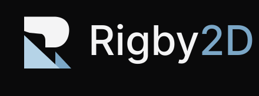
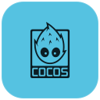
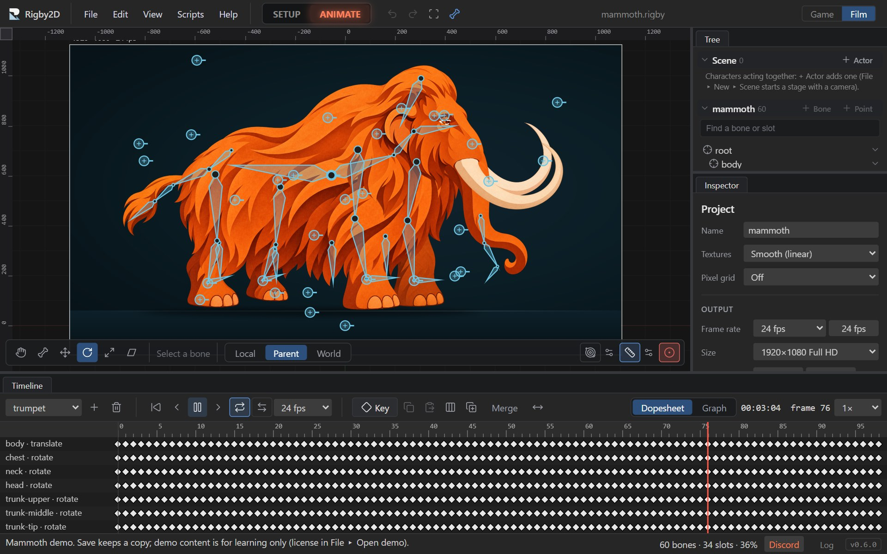

<p align="center">
  
</p>

<p align="center">
  <a href="../README.md">English</a> · <a href="README.ja.md">日本語</a> · <b>简体中文</b> · <a href="README.ko.md">한국어</a> · <a href="README.es.md">Español</a> · <a href="README.pt-BR.md">Português (Brasil)</a>
</p>

<h3 align="center">面向游戏与影视的开源 2D 骨骼动画。</h3>

<p align="center">
  用骨骼和网格绑定你的美术，制作动画，渲染成影片，并发布到任意游戏引擎。永久免费。
</p>

<p align="center">
  <a href="https://rigby2d.com/editor/"></a>
  <a href="https://rigby2d.com/#download"></a>
  <a href="https://discord.gg/PGgaTwbNH"></a>
  <br>
  <sub>Windows · macOS · Linux · 也可在浏览器中使用完整编辑器，无需安装</sub>
</p>

<p align="center">
  <a href="https://rigby2d.com/">网站</a> · <a href="https://rigby2d.com/docs/">文档</a> · <a href="https://rigby2d.com/blog/">开发日志</a> · <a href="https://rigby2d.com/addons/">插件</a>
</p>

<p align="center">
  <a href="https://alternativeto.net/software/rigby2d/about/?utm_source=badge&utm_medium=referral"></a><br>
  <sub>已在 AlternativeTo 上作为 Spine、DragonBones 和 Live2D 的替代品收录</sub>
</p>

<h3 align="center">在你正在使用的引擎中播放</h3>

<table align="center">
  <tr>
    <td align="center" width="104"><a href="../runtimes/godot/addons/rigby2d/README.md"><br><b>Godot</b></a><br><sub>4.3+</sub></td>
    <td align="center" width="104"><a href="../runtimes/unity/com.rigby2d.unity/README.md"><br><b>Unity</b></a><br><sub>2021.3+ · 6</sub></td>
    <td align="center" width="104"><a href="../runtimes/defold/README.md"><br><b>Defold</b></a><br><sub>1.14+</sub></td>
    <td align="center" width="104"><a href="../runtimes/cocos/README.zh-CN.md"><br><b>Cocos Creator</b></a><br><sub>3.8</sub></td>
    <td align="center" width="104"><a href="../runtimes/phaser/README.md"><br><b>Phaser</b></a><br><sub>3.60+ · 4</sub></td>
    <td align="center" width="104"><a href="../runtimes/pixi/README.md"><br><b>PixiJS</b></a><br><sub>8 · WebGPU</sub></td>
    <td align="center" width="104"><a href="../docs/runtimes.md#javascript"><br><b>JavaScript</b></a><br><sub>任意引擎</sub></td>
    <td align="center" width="104"><a href="../runtimes/README.md"><br><b>Rust</b></a><br><sub>原生</sub></td>
  </tr>
</table>

<p align="center"><sub>八个免费开源的运行时。每一个都与编辑器逐帧播放相同的动画。</sub></p>

<p align="center">
  
  <a href="#license"></a>
  <a href="https://github.com/jaisurya-dev-art/rigby2d/stargazers"></a>
  <a href="https://upstar.dev/r/jaisurya-dev-art/rigby2d"></a>
  <a href="../CONTRIBUTING.md"></a>
</p>

<p align="center">
  <a href="https://youtu.be/Yqh1_XLBHsU"></a><br>
  <sub>▶ <a href="https://youtu.be/Yqh1_XLBHsU">Rigby2D 0.6 Mammoth</a></sub>
</p>

<p align="center">
  <br>
  <sub>0.6 编辑器打开猛犸象演示：视口中是它的骨架，摄影表中是鸣叫动画，右侧停靠着树和检查器。</sub>
</p>

## 媒体报道与社区收录

- **Polydium（CG · VFX · 游戏每日简报）：** [Rigby2D — 自动绑定分层 PSD 的开源 2D 骨骼动画编辑器](https://polydium.net/briefing/8df9db93-0abf-4032-bd88-acbdf95ec431) —— 入选韩国 [Polydium 管线简报](https://polydium.net/briefing) 重点推荐工具。
- **开源与 AI 索引目录：** 收录于 [Trendshift 2026 开源游戏引擎项目](https://trendshift.io/topics/game-engine)、[Nicheloom](https://www.nicheloom.com/launches/57217/) 与 [Context7](https://context7.com/jaisurya-dev-art/rigby2d)。

## 文档

**[阅读文档](https://rigby2d.com/docs/)**（英文）：编辑器、运行时和 MCP 服务器每个部分的带截图指南。这些页面也在 [`docs/`](../docs/) 中。

| 入门 | 绑定 | 动画 | 发布与自动化 |
| --- | --- | --- | --- |
| [安装](https://rigby2d.com/docs/installation.html) | [导入美术](https://rigby2d.com/docs/importing-art.html) | [制作动画](https://rigby2d.com/docs/animating.html) | [导出](https://rigby2d.com/docs/export.html) |
| [快速开始](https://rigby2d.com/docs/quick-start.html) | [AutoRig](https://rigby2d.com/docs/autorig.html) | [曲线编辑器](https://rigby2d.com/docs/graph-editor.html) | [运行时](https://rigby2d.com/docs/runtimes.html) |
| [界面](https://rigby2d.com/docs/interface.html) | [骨骼与插槽](https://rigby2d.com/docs/bones-and-slots.html) | [姿势与表情](https://rigby2d.com/docs/poses-and-faces.html) | [Python 脚本](https://rigby2d.com/docs/scripting.html) |
| [从 Spine 迁移](https://rigby2d.com/docs/migrating-from-spine.html) · [从 DragonBones 迁移](https://rigby2d.com/docs/migrating-from-dragonbones.html) | [网格](https://rigby2d.com/docs/meshes.html) · [约束](https://rigby2d.com/docs/constraints.html) | [影片](https://rigby2d.com/docs/film.html) · [场景](https://rigby2d.com/docs/scenes.html) · [口型同步](https://rigby2d.com/docs/lip-sync.html) | [AI 助手（MCP）](https://rigby2d.com/docs/mcp.html) · [插件](https://rigby2d.com/docs/addons.html) |

## 功能

- **AutoRig**：分层的 PSD、SVG 或 Aseprite 文件一步变成可编辑的骨架：骨骼、关节、可弯曲的网格和 IK。
- **统一设计语言的界面**：任意面板都能停靠到任何位置或其他面板的标签页中；绑定面板、可保存的布局，以及主题（Rigby Dark、Mammoth、Rigby Light，或你自己的 `.rigbytheme`）。
- **完整的绑定工具**：骨骼与点骨骼、可锁定顶点和挖洞的权重网格、链接网格、图片序列、皮肤、事件、裁剪和路径，以及永不跳变的 IK、变换、路径、物理和滑块约束。刷权重时可以测试姿势或让骨骼摆动；骨架建好后也能移动关节而不移动美术。
- **2.5D 转向与变形器**：一个手柄就能让头部在纵深中转动和倾斜，每一侧都可以手动塑形，嵌套晶格能弯曲任何网格。所有效果都能在每个运行时中播放。
- **动画**：设置与动画模式、带补间线的摄影表、带贝塞尔手柄的曲线编辑器、洋葱皮、姿势库、表情控制，以及角色之间的动画重定向。
- **影片工作区**：4K、时间码、可动画的摄像机、音轨、基于本地 Whisper 转写的视素口型同步，以及**影片特效**（投影、光照着色、辉光、模糊、调色、粒子、运动模糊、景深），在 GPU 上渲染为 PNG 序列、带透明通道的 WebM 和 MP4。
- **场景合成**：多个角色作为演员同台，使用类似非线性剪辑的片段（裁剪、变速、循环、交叉淡化、独立音频）、带视差的绘制图层和摄像机，并可由运行时在游戏中播放。参见[场景](https://rigby2d.com/docs/scenes.html)。
- **作品安全有保障**：保存绝不留下写了一半的文件，类似 Blender `.blend1` 的 `.rigby1` 备份，自动保存和崩溃恢复。参见[保存与恢复](https://rigby2d.com/docs/recovery.html)。
- **偏好设置与插件**：界面语言（英语、日语、中文、韩语、西班牙语、葡萄牙语）、界面缩放、可选 Reference 或 Blender 风格按键的快捷键，以及在沙盒中运行的 Python 插件库。参见[插件](https://rigby2d.com/docs/addons.html)。
- **从其他工具迁移**：可打开 Spine 导出文件（附迁移检查器）、DragonBones 项目和 Aseprite 文件（标签会变成动画）。参见[从 Spine 迁移](https://rigby2d.com/docs/migrating-from-spine.html)和[从 DragonBones 迁移](https://rigby2d.com/docs/migrating-from-dragonbones.html)。
- **自动化**：Python 脚本、`rigby` 命令行（在脚本和 CI 中转换、校验、导出、AutoRig 和 GPU 渲染，参见[命令行](https://rigby2d.com/docs/cli.html)），以及内置的 **MCP 服务器**，让 Claude 等 AI 助手检查、绑定和制作你的项目动画。
- **无损的骨架 JSON（3.8、4.2、4.3）和二进制 `.skel`**，附纹理图集，可由九个运行时播放：**JavaScript、Phaser、PixiJS、Rust、C++（Defold）、Unity、Godot、Cocos Creator 和 Python（Ren'Py）**，全部逐帧与编辑器比对。*文件 ▸ 获取运行时* 即可安装。
- **精灵表**：面向逐帧播放的引擎，打包为 TexturePacker/Aseprite 风格的 JSON、Defold 图集或 PNG 帧，循环首尾相接。
- **欢迎界面、教程和演示**：应用内课程、桌面版的签名自动更新，以及演示项目（**Mammoth**、**NILA**、**Rigbytron** 和两人同台的**场景**），也可在[演示页面](https://rigby2d.com/demos/)获取可直接用于游戏的导出（演示内容 © Rigby2D，适用其[演示许可](../branding/DEMO-LICENSE.md)）。

## 开始使用

- **在浏览器中：**[打开编辑器](https://rigby2d.com/editor/)，无需安装。
- **Windows：**[下载便携版](https://github.com/jaisurya-dev-art/rigby2d/releases/latest/download/Rigby2D_x64_portable.exe)，或从 [Releases](https://github.com/jaisurya-dev-art/rigby2d/releases) 下载安装程序。
- **macOS：**[下载 .dmg](https://github.com/jaisurya-dev-art/rigby2d/releases/latest/download/Rigby2D_universal.dmg)（Apple 芯片和 Intel）。首次打开时右键 ▸ 打开（见[安装说明](https://rigby2d.com/docs/installation.html)）。
- **Linux：**[下载 AppImage](https://github.com/jaisurya-dev-art/rigby2d/releases/latest/download/Rigby2D_amd64.AppImage)，或从 [Releases](https://github.com/jaisurya-dev-art/rigby2d/releases) 下载 `.deb`。
- **AI 助手：**在 Claude Desktop 中安装 [Rigby2D-AI.mcpb](https://github.com/jaisurya-dev-art/rigby2d/releases/latest/download/Rigby2D-AI.mcpb)，或参阅 [MCP 指南](https://rigby2d.com/docs/mcp.html)。
- **从源码构建**（Node.js 20+ 和 [Tauri 前置条件](https://tauri.app/start/prerequisites/)）：

```bash
git clone https://github.com/jaisurya-dev-art/rigby2d.git
cd rigby2d
npm install
npm run dev        # 桌面版；浏览器版用 npm run web:dev，测试用 npm test
```

## 项目结构

```
src/core/       运行时：数据模型、骨骼 JSON/.skel 与图集读写、姿势计算、约束、播放
src/editor/     编辑器界面：视口、树、检查器、摄影表、曲线编辑器、导入导出、脚本
src/webgl/      运行时的参考 WebGL 渲染器
src/mcp/        面向 AI 助手的 Model Context Protocol 服务器
runtimes/       Rust、C++（Defold）、Godot、Unity、Cocos Creator 和 Phaser 运行时
addons/         官方插件
site/           网站与文档站点（GitHub Pages）
docs/           文档页面与图片
branding/       标志、图标、Rigbytron 和 NILA（专有，见 TRADEMARKS.md）
src-tauri/      原生桌面外壳
test/           node:test 测试
```

## 参与贡献

欢迎贡献！开发环境、代码风格和拉取请求流程请参阅 [CONTRIBUTING.md](../CONTRIBUTING.md)（英文）。

## 支持 Rigby2D

Rigby2D 免费且开源，并将一直如此。每月的支持用于一个人难以承担的开销，首先是**以 Rigby2D 名义的代码签名**，让 Windows 和 macOS 不再向下载者显示警告。第一个目标是每月 25 美元；前 20 位每月支持者将永久成为 Founding Supporter（创始支持者）。

<a href="https://github.com/sponsors/jaisurya-dev-art"></a>
&nbsp;[资金用途](https://rigby2d.com/fund/)

## 许可证

Rigby2D 的源代码可任选以下任一许可证使用：

- [MIT License](../LICENSE-MIT)
- [Apache License, Version 2.0](../LICENSE-APACHE)

© 2026 [jaisurya-dev-art](https://github.com/jaisurya-dev-art)。除非另有说明，你提交给 Rigby2D 的贡献将按上述两种许可证授权，不附加任何其他条款。编辑器为 Python 脚本附带了 Pyodide 和 CPython，适用其各自的许可证（见 [THIRD_PARTY_NOTICES.md](../THIRD_PARTY_NOTICES.md)）。

## 商标

**Rigby2D**、**Rigbytron** 和 **NILA**，以及 [`branding/`](../branding/) 中的 Rigby2D 标志、组合标、图标和 Rigbytron、NILA 吉祥物，均为 Rigby2D 项目的专有商标，不受 MIT 或 Apache 2.0 许可证覆盖。分支和修改版本必须使用自己的名称和品牌。详见 [TRADEMARKS.md](../TRADEMARKS.md)。

## 免责声明

Rigby2D 是独立的开源项目，与任何其他动画软件的开发者均无关联，也未获其认可或赞助。所有商标归其各自所有者所有。对骨骼 JSON、二进制 `.skel` 和纹理图集格式的支持仅用于互操作，并以净室方式实现。详见[英文免责声明](../README.md#disclaimer)。

<sub>本译文仅供参考。许可证、商标和免责声明以英文版（README.md）为准。</sub>
