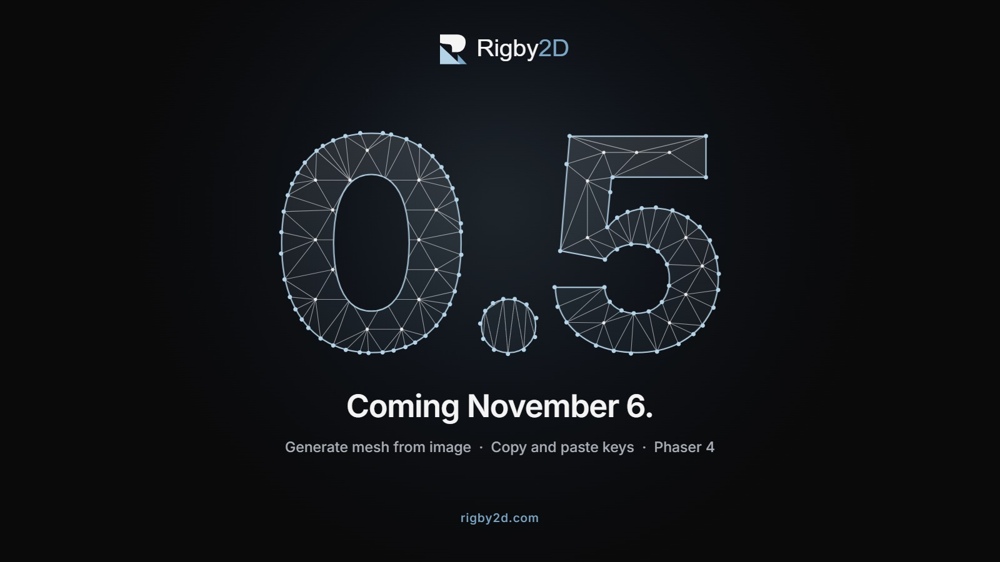

Rigby2D 0.5 comes out on **Friday, November 6**. Everything in it is already live in the
[browser editor](https://rigby2d.com/editor/), so you can try it today. The desktop app gets it with
the release. [中文版本](/blog/coming-in-0-5-zh.html).

## Generate a mesh from your art

Building a mesh used to mean clicking every vertex around a sprite. Now the mesh panel has
**Generate from image**: Rigby2D traces the image's alpha, simplifies the outline to exactly the
number of points you ask for, adds evenly spaced vertices inside, and triangulates.

- **Outline points** sets the vertex budget exactly: few for a prop, more where the art bends.
- **Alpha threshold**, **Expand** and **Smoothing** decide what counts as the shape and how closely
  the outline hugs it.
- **Interior** (none, low, medium, high) adds the inner vertices that let a part bend smoothly.
- The outline always contains the art, even with few points: its edges are pushed out so they never
  cut into the image.
- After the first generate, changing a setting regenerates the mesh live. A weighted mesh keeps its
  bones, with the weights carried over to the new vertices.

The result is an ordinary mesh, so every manual tool still works on it. The artwork above is the
feature drawing itself: each numeral is the mesh it generates. This came from a
[feature request on GitHub](https://github.com/jaisurya-dev-art/rigby2d/issues/23), and the
[Meshes guide](/docs/meshes.html#generating-a-mesh-from-the-image) has the details.

## Copy and paste keys

The dopesheet can now **copy and paste keys**, contributed by
[maruccimauro](https://github.com/maruccimauro):

- Select frame columns or several regions at once, with a live preview of where the paste lands.
- Paste with **Merge**, **Overwrite** or **Overwrite all**, and choose what happens when a paste runs
  past the end of the animation.
- Keys keep their tracks by name, so a paste into another animation, or after bones were added or
  removed, lands on the same bone, slot, deform or IK track.
- It works in the detached timeline window too.

## The Phaser plugin runs on Phaser 4

The Phaser plugin now works on **Phaser 4** as well as Phaser 3.60 and newer. Phaser 4 hands the
WebGL context to plugins in a new way, and it left texture uploads flipped, which drew every part
from the wrong place in the atlas. Both are handled, and the same scene now looks identical on
Phaser 3.90 and 4.2. Thanks to the
[detailed report](https://github.com/jaisurya-dev-art/rigby2d/issues/24) that pinned it down.

## Fixes

- **Moving a mesh to another bone no longer crashes.** Converting an image to a mesh and then
  assigning it to a bone raised an error; meshes now move their vertices and stay exactly in place.
  ([#22](https://github.com/jaisurya-dev-art/rigby2d/issues/22))
- **AutoRig points the spine at the head**, even for a wide torso such as a jacket, where the chest
  bone could come out tilted.
- **DragonBones files open the character**, not a weapon or a bullet that the file lists first.
- **The Scripts menu stays short**: each add-on's tools sit in a submenu named after it, and a menu
  taller than the window scrolls. The **Breathing idle** add-on (1.1) now breathes through the upper
  body instead of swelling the chest.

## November 6

0.5.0 lands on the [Releases page](https://github.com/jaisurya-dev-art/rigby2d/releases) on
Friday, with installers for Windows, macOS and Linux, the portable app, and every runtime. If you
already have Rigby2D, the editor offers the update by itself.

Until then, [open the browser editor](https://rigby2d.com/editor/) and try it, and tell us what you
think on [r/rigby2d](https://www.reddit.com/r/rigby2d/) or in the
[GitHub issues](https://github.com/jaisurya-dev-art/rigby2d/issues).
