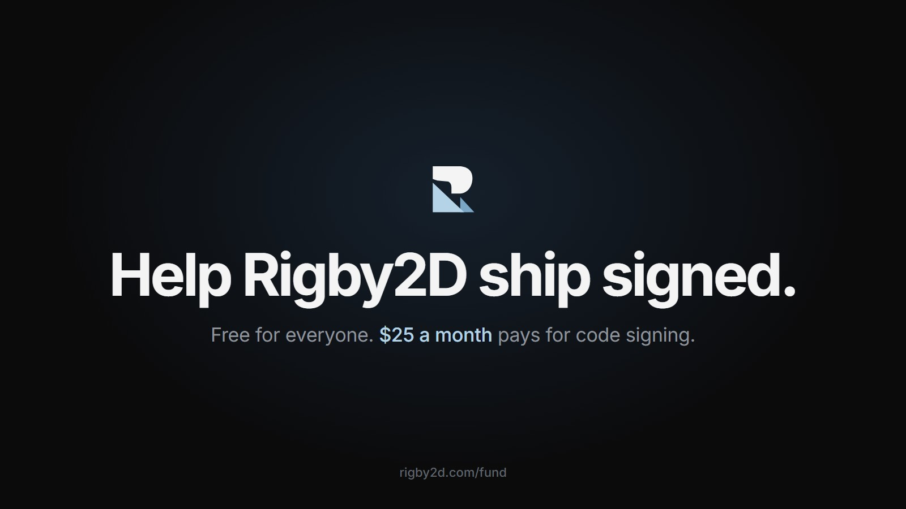

如果你在 Windows 上安装过 Rigby2D，一定见过那个蓝色窗口：“Windows 已保护你的电脑”，发布者“未知”。
在 Mac 上情况更糟。这个窗口，是 Rigby2D 与下一位想尝试它的动画师之间最大的障碍。

解决办法是一张以 Rigby2D 名义签发、每年续期的代码签名证书，以及用于公证 Mac 应用的 Apple 开发者会员资格。
两者合计约 **每月 25 美元**。

所以从今天起，你可以支持 Rigby2D：[rigby2d.com/fund](/fund/)。

## 不会改变的

Rigby2D 依然免费、开源：编辑器、所有运行时和所有功能，商业使用无需授权费。支持不会解锁任何功能，
它只用来支付一个人难以承担的开销，首先就是证书。

## 你会得到

- **每月 3 美元起**：你的名字出现在 [rigby2d.com](/#support) 的支持者墙上。
- **每月 5 美元起**：你的名字出现在编辑器内（*帮助 ▸ 支持者*），并在 [r/rigby2d](https://www.reddit.com/r/rigby2d/) 获得支持者标识。
- **每月 10 美元起**：名字附带链接，并可参与路线图投票。
- **工作室** 的标志将出现在 README 和网站上。
- **前 20 位每月支持者将永久成为创始支持者。**

也支持一次性赞助和自定义金额。

## 资金用途

| 每月 | 用途 |
| --- | --- |
| 25 美元 | Windows 和 macOS 代码签名 |
| 60 美元 | 域名、测试设备、引擎授权、AutoRig 和 AI 功能的 GPU 费用 |
| 300 美元 | 每月整天专注于 Rigby2D 的开发时间 |

每个月，开发日志都会公开收入和用途。

如果 Rigby2D 为你省下了一笔授权费，或者一个下午，现在就是支持它的时候：
**[支持 Rigby2D](https://github.com/sponsors/jaisurya-dev-art)**。如果手头紧，点一颗星、分享一下或提交一个 bug，同样很有帮助。
