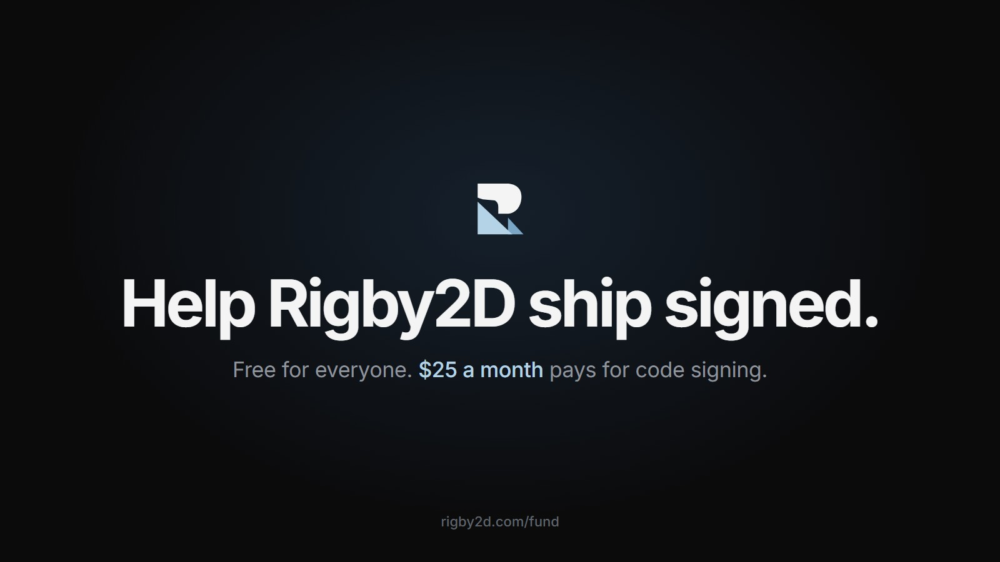

If you've installed Rigby2D on Windows, you've seen it: a blue screen saying *Windows protected your
PC*, from an "unknown publisher". On a Mac it's worse. That screen is the single biggest thing
standing between Rigby2D and the next animator who tries it.

The fix is a code-signing certificate in Rigby2D's name, renewed every year, and Apple's developer
membership to notarize the Mac app. Together that's about **$25 a month**.

So from today, Rigby2D can be supported: [rigby2d.com/fund](/fund/).

## What doesn't change

Rigby2D stays free and open source: the editor, every runtime, every feature, with no runtime fees.
Supporting never unlocks anything. It pays for what one person can't, starting with the certificate.

## What you get

- **From $3 a month**, your name on the supporters wall on [rigby2d.com](/#support).
- **From $5**, your name inside the editor (*Help ▸ Supporters*) and a supporter flair on
  [r/rigby2d](https://www.reddit.com/r/rigby2d/).
- **From $10**, your name linked, and a vote in the roadmap polls.
- **Studios** get their logo in the README and on the site.
- **The first 20 monthly supporters are Founding Supporters**, for good.

There's a one-time option too, and you can give any amount you like.

## Where the money goes

| Monthly | Pays for |
| --- | --- |
| $25 | Code signing on Windows and macOS |
| $60 | The domain, test devices, engine licences, GPU time for AutoRig and AI features |
| $300 | Whole days each month spent only on Rigby2D |

Every month the devlog will show what came in and what it paid for.

If Rigby2D saved you a licence fee, or an afternoon, this is the moment:
**[Support Rigby2D](https://github.com/sponsors/jaisurya-dev-art)**. And if money's tight, a star, a
share or a bug report helps just as much.
