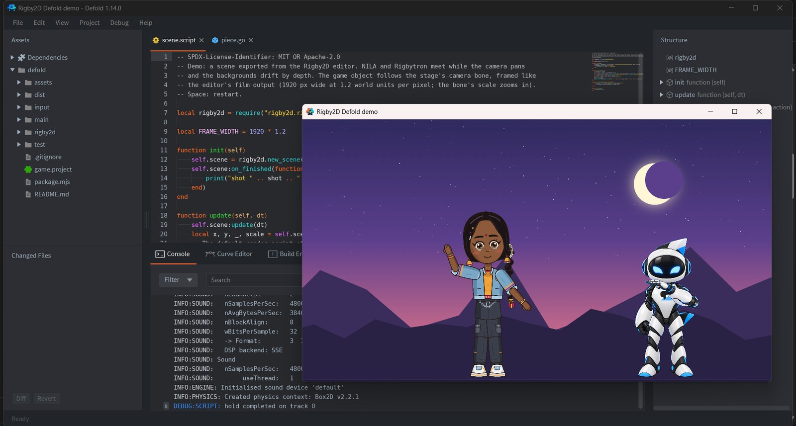
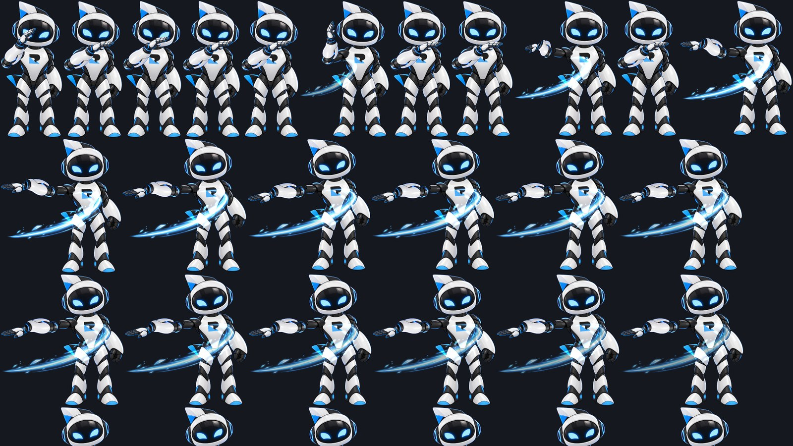

Rigby2D 0.5 的内容更多了。[r/rigby2d](https://www.reddit.com/r/rigby2d/) 上呼声最高的两项功能加入了这个版本：
**Defold 运行时** 和 **精灵图集导出**。它们将与 [第一篇 0.5 预告](/blog/coming-in-0-5-zh.html) 中的所有内容一起，
在 **11 月 6 日（周五）** 随 0.5 发布。[English](/blog/defold-and-sprite-sheets.html)。



## Defold：完整的运行时

不是预览版，也不是社区移植。Defold 运行时是用 C++ 重写的 Rigby2D 运行时，作为原生扩展，由 Defold 的构建服务器为
**Windows、macOS、Linux、Android、iOS 和 HTML5** 编译。编辑器能做的它都能播放：网格与权重、IK、变换、路径、物理和滑块约束、
皮肤、裁剪、双色着色、混合模式、事件、带交叉淡入的分层轨道，以及包含舞台、多个角色、摄像机和视差的完整 **场景**。

```lua
local rigby2d = require("rigby2d.rigby2d")

function init(self)
	self.hero = rigby2d.new({ skeleton = "/assets/hero.skel", atlas = "/assets/hero.atlas", animation = "idle" })
	self.hero:on_event(function(e) if e.name == "footstep" then sound.play("#step") end end)
end

function update(self, dt)
	self.hero:update(dt)
end
```

- **与编辑器完全一致的动画。** JavaScript 运行时是参考实现，每次提交时 CI 都会逐帧比对 C++ 运行时的输出：骨骼矩阵、顶点、
  颜色、绘制顺序和事件。Rigbytron 上最大误差为 2 × 10⁻¹⁶；带辫子物理的 NILA 上为 3 × 10⁻⁹。
- **快。** C++ 代码把每一帧的三角形直接写入 Defold 的顶点缓冲区，Lua 中没有逐顶点的工作，稳定播放时不分配内存。
  NILA（39 根骨骼、890 个网格顶点、物理）每帧摆姿势约 12 微秒。
- **一个依赖即可。** 把库的 URL 加到 *game.project*，Defold 会自动构建。在编辑器中，*文件 ▸ 获取运行时 ▸ Defold*
  可以复制这个 URL，并提供演示项目。

库的 URL 将在周五发布时上线。在此之前，可以把
[`runtimes/defold/rigby2d`](https://github.com/jaisurya-dev-art/rigby2d/tree/develop/runtimes/defold)
文件夹复制到你的项目中。完整 API 见 [Defold 指南](https://github.com/jaisurya-dev-art/rigby2d/blob/develop/runtimes/defold/README.md)。

## 精灵图集

对于逐帧播放而不是使用骨骼的引擎，或者要把动画交给使用 Aseprite 的同伴，*文件 ▸ 导出 ▸ 精灵图集…* 会把动画逐帧渲染出来。



- **三种格式：** 带 **JSON hash** 的打包 PNG（TexturePacker 的格式，Phaser、PixiJS 和大多数导入工具都能读取，包含
  Aseprite 的帧标签和位于角色原点的轴心）、带帧图片的 **Defold 图集**，或单独的 **PNG 帧**。
- **首尾相接的循环。** 去掉重复的最后一帧，并在取帧前先把循环播放一遍，让头发和布料的物理从最后一帧自然衔接到第一帧。
- **更小的图集。** 每帧裁剪到可见像素，相同的帧只存一次，可选择紧密打包或网格布局、间距和尺寸。
- **像素风保持清晰。** 当项目纹理设为 *Nearest* 时，帧采样不做平滑。
- **在哪里导出都一样。** 帧由 Rigby2D 内置的渲染器绘制，支持双色着色和所有混合模式，所以在浏览器、桌面版或
  [MCP 服务器](/docs/mcp.html)（`export_sprite_sheet`）中导出的结果完全相同。

现在就可以在 [浏览器编辑器](https://rigby2d.com/editor/) 中使用：图集会以 zip 下载。

## 其他更新

- **Godot 运行时结束预览。** `RigbySkeleton2D` 和 `RigbyScene2D` 已经完整，提供 Windows、macOS 和 Linux 下载。
- **分层 PNG 原位导入。** 把图层导出为同尺寸的 PNG（Photoshop 的 *将图层导出到文件*，或任何保留完整画布的导出），
  *文件 ▸ 导入 ▸ PNG 图像…* 会像 PSD 一样把每个图层放回原位，直接用于 [AutoRig](/docs/autorig.html)。
- **所有运行时的专页。** [rigby2d.com/runtimes](/runtimes/) 展示全部七个运行时、与 Spine 运行时的对比，
  以及由你的浏览器实时驱动的一群 NILA：试试 200 个。
- **文档已更新。** 摄影表的复制粘贴、帮助菜单、插件子菜单和快捷键列表都已写入文档，所有运行时列表都加入了 Defold 和 Cocos Creator。

## 周五见

0.5.0 将于 11 月 6 日在 [Releases 页面](https://github.com/jaisurya-dev-art/rigby2d/releases) 发布，包含 Windows、macOS 和
Linux 安装包以及所有运行时（包括 Defold）。已经安装 Rigby2D 的用户会在编辑器中收到更新提示。有问题，或者有 Defold 游戏想展示？
欢迎来 [r/rigby2d](https://www.reddit.com/r/rigby2d/) 打个招呼。
