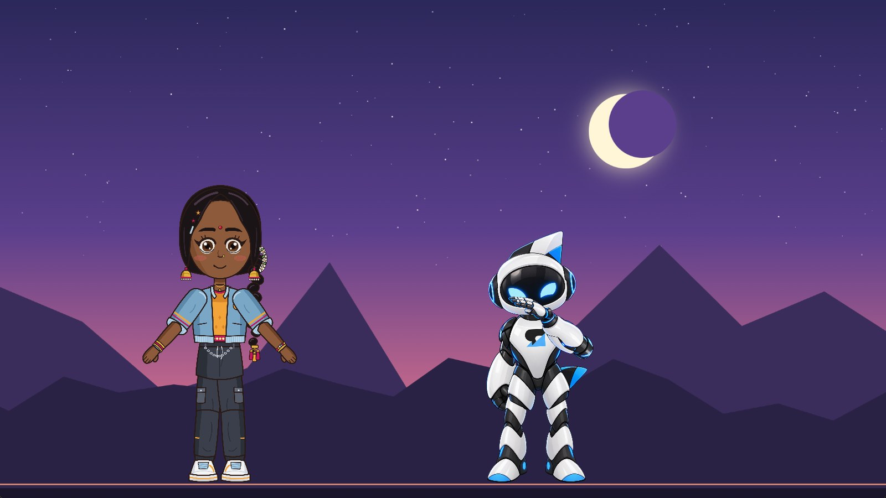
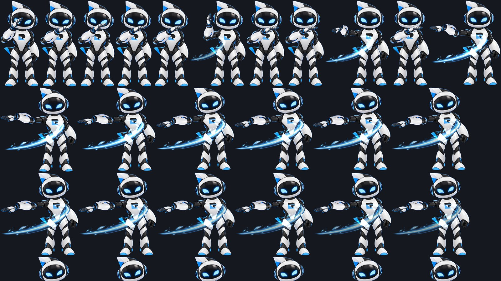

Rigby2D 0.5 got bigger. Two of the most asked-for features on
[r/rigby2d](https://www.reddit.com/r/rigby2d/) made it in: a **Defold runtime** and **sprite sheet
export**. Both come with 0.5 on **Friday, November 6**, along with everything in the
[first 0.5 preview](/blog/coming-in-0-5.html). [中文版本](/blog/defold-and-sprite-sheets-zh.html).



## Defold, as a full runtime

Not a preview, and not a community port. The Defold runtime is the Rigby2D runtime rewritten in C++,
a native extension that Defold's build server compiles for **Windows, macOS, Linux, Android, iOS
and HTML5**. It plays everything the editor makes: meshes and weights, IK, transform, path, physics
and slider constraints, skins, clipping, two-color tint, blend modes, events, layered tracks with
crossfades, and whole **scenes** with a stage, several characters, a camera and parallax.

```lua
local rigby2d = require("rigby2d.rigby2d")

function init(self)
	self.hero = rigby2d.new({ skeleton = "/assets/hero.skel", atlas = "/assets/hero.atlas", animation = "idle" })
	self.hero:on_event(function(e) if e.name == "footstep" then sound.play("#step") end end)
end

function update(self, dt)
	self.hero:update(dt)
end
```

- **The same animation as the editor.** The JavaScript runtime is the reference, and on every
  commit CI replays its output against the C++ one, frame by frame: bone matrices, vertices,
  colors, draw order and events. On Rigbytron the largest difference is 2 × 10⁻¹⁶; on NILA, with
  physics on her braid, 3 × 10⁻⁹.
- **Fast.** The C++ code writes each frame's triangles straight into Defold's vertex buffers, with
  no work per vertex in Lua and nothing allocated in steady playback. NILA (39 bones, 890 mesh
  vertices, physics) poses in about 12 µs.
- **One dependency.** Add the library URL to *game.project* and Defold builds it for you. In the
  editor, *File ▸ Get runtimes ▸ Defold* copies the URL and has a demo project.

The library URL goes live with the release on Friday. Until then, copy the
[`runtimes/defold/rigby2d`](https://github.com/jaisurya-dev-art/rigby2d/tree/develop/runtimes/defold)
folder into your project. The [Defold guide](https://github.com/jaisurya-dev-art/rigby2d/blob/develop/runtimes/defold/README.md)
has the whole API.

## Sprite sheets

For engines that play frames instead of bones, or to hand an animation to someone who works in
Aseprite, *File ▸ Export ▸ Sprite sheet…* renders your animations frame by frame.



- **Three formats:** a packed PNG with a **JSON hash** (TexturePacker's layout, read by Phaser,
  PixiJS and most importers, with Aseprite's frame tags and a pivot at the character's origin), a
  **Defold atlas** with its frames, or plain **PNG frames**.
- **Loops that join up.** The repeated last frame is left out, and physics plays the loop once
  before the frames are taken, so hair and cloth flow from the last frame into the first.
- **Small sheets.** Frames are trimmed to their visible pixels, identical frames are stored once,
  and you choose a packed or a grid layout, padding and size.
- **Pixel art stays crisp.** With the project's textures set to *Nearest*, frames are sampled
  without smoothing.
- **Same result everywhere.** Frames are drawn by a renderer built into Rigby2D, with two-color
  tint and every blend mode, so a sheet from the browser, the desktop app or the
  [MCP server](/docs/mcp.html) (`export_sprite_sheet`) is identical.

It is in the [browser editor](https://rigby2d.com/editor/) today: sheets download as a zip.

## Also new

- **The Godot runtime is out of preview.** `RigbySkeleton2D` and `RigbyScene2D` are complete, with
  downloads for Windows, macOS and Linux.
- **Layered PNGs land in place.** Export your layers as same-size PNGs (Photoshop's *Export Layers
  to Files*, or any full-canvas export) and *File ▸ Import ▸ PNG images* places each where it was
  drawn, like a PSD, ready for [AutoRig](/docs/autorig.html).
- **A page for every runtime.** [rigby2d.com/runtimes](/runtimes/) shows all seven, how they compare
  with Spine's, and a live crowd of NILAs your browser animates: try 200.
- **Docs caught up.** Dopesheet copy and paste, the Help menu, add-on submenus and the shortcut list
  are documented, and every runtime list now includes Defold and Cocos Creator.

## Friday

0.5.0 lands on the [Releases page](https://github.com/jaisurya-dev-art/rigby2d/releases) on
November 6 with installers for Windows, macOS and Linux and every runtime, Defold included. If you
have Rigby2D, the editor offers the update itself. Questions, or a Defold game to show? Come say hi
on [r/rigby2d](https://www.reddit.com/r/rigby2d/).
