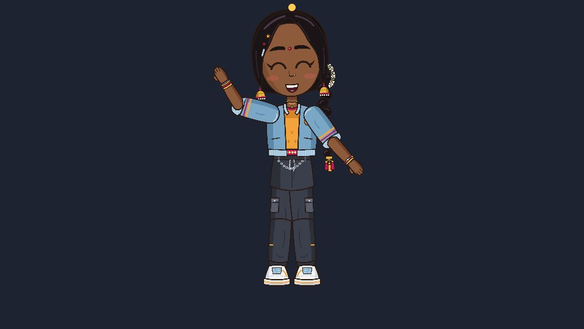

有观众在 YouTube 上问：不用 Phaser Editor，怎么在 Phaser 里加入动画角色？答案是：根本不需要它。
Rigby2D 的 Phaser 运行时就是一个普通插件，只有一个文件，角色就像普通精灵一样是一个游戏对象。
下面用 NILA 从头到尾走一遍。



## 1. 导出角色

在 Rigby2D 中打开你的角色（或 *文件 ▸ 打开演示… ▸ NILA*），选择
*文件 ▸ 导出 ▸ 二进制 .skel + 图集（4.3）…*。会得到三个文件：`nila.skel`、`nila.atlas` 和
`nila.png`，把它们放进 `assets` 文件夹。

## 2. 获取插件

在编辑器中，*文件 ▸ 获取运行时… ▸ Phaser ▸ ES module* 会保存 `rigby2d-phaser-<版本>.mjs`
（也可以在 [Releases 页面](https://github.com/jaisurya-dev-art/rigby2d/releases/latest) 下载）。
把它重命名为 `rigby2d-phaser.mjs`，放在游戏旁边。文件夹结构如下：

```
my-game/
  index.html
  main.js
  rigby2d-phaser.mjs
  assets/
    nila.skel  nila.atlas  nila.png
```

## 3. 加载 Phaser 的页面

`index.html` 从 CDN 加载 Phaser，并以模块方式加载你的游戏：

```html
<!doctype html>
<html>
  <body style="margin: 0; background: #1b1b1b">
    <script src="https://cdn.jsdelivr.net/npm/phaser@3.90.0/dist/phaser.min.js"></script>
    <script type="module" src="./main.js"></script>
  </body>
</html>
```

插件同样支持 Phaser 4。

## 4. 游戏代码

`main.js` 注册插件、加载角色并把她放到舞台上：

```js
import { rigbyPhaser } from './rigby2d-phaser.mjs';

const { RigbyPlugin } = rigbyPhaser(Phaser);

class Level extends Phaser.Scene {
  preload() {
    this.load.rigby('nila', 'assets/nila.skel', 'assets/nila.atlas');
  }

  create() {
    // x, y (where her feet go), key, animation. It loops by default.
    this.nila = this.add.rigby(480, 520, 'nila', 'idle');
    this.nila.setScale(0.18);

    // Space: wave once, then back to idle with a soft crossfade.
    this.input.keyboard.on('keydown-SPACE', () => {
      this.nila.play('wave', false, 0.2);
      this.nila.queue('idle', true, 0.3);
    });

    // Keys you set in the editor's timeline arrive as events.
    this.nila.on('event', (entry, event) => console.log('event:', event.name));

    // A sparkle that follows her head bone.
    this.sparkle = this.add.circle(0, 0, 6, 0xffcc55);

    this.keys = this.input.keyboard.createCursorKeys();
  }

  update(time, delta) {
    if (this.keys.left.isDown) {
      this.nila.x -= 0.2 * delta;
      this.nila.flipX = true;
    } else if (this.keys.right.isDown) {
      this.nila.x += 0.2 * delta;
      this.nila.flipX = false;
    }
    const head = this.nila.boneWorld('head');
    this.sparkle.setPosition(head.x, head.y - 130);
  }
}

new Phaser.Game({
  type: Phaser.WEBGL,
  width: 960,
  height: 540,
  backgroundColor: '#1d2330',
  plugins: { scene: [{ key: 'RigbyPlugin', plugin: RigbyPlugin, mapping: 'rigby' }] },
  scene: Level,
});
```

关键只有四行：`rigbyPhaser(Phaser)` 得到插件，`plugins` 一项安装插件，`this.load.rigby`
加载文件，`this.add.rigby` 创建角色。

## 5. 运行

浏览器不允许从 `file://` 加载模块，所以用任意本地服务器打开这个文件夹：

```bash
npx serve .
```

打开它输出的地址。方向键让她走动，空格让她挥手，小光点无论她做什么都停在她头顶。

## 刚才发生了什么

- **`play(name, loop, mix)`** 播放动画，并在 `mix` 秒内从当前动画交叉淡入。**`queue`**
  排好下一个动画，所以挥手结束后会自然回到待机。
- **`flipX`** 让她转身，和其他 Phaser 游戏对象一样。位置、缩放、旋转、透明度、深度和输入都照常可用。
- **`boneWorld('head')`** 每一帧给出骨骼在场景中的位置。可以挂帽子、武器、粒子或碰撞框。
- 在编辑器时间轴上设置的 **事件**（脚步声、挥剑命中）会触发 `'event'`，`'complete'`
  则在动画结束时通知你。

你在 Rigby2D 中做的一切都会带过来：网格、她辫子上的物理、IK、皮肤和混合模式，播放效果与编辑器完全一致。

## 更快的方式：入门项目

想一分钟跑起来？编辑器欢迎屏幕上有 **Phaser 游戏入门项目**：舞台上的 NILA，会走、会挥手，还能用交叉淡入切换情绪。
也可以直接下载：[rigby2d-phaser-starter.zip](/starters/rigby2d-phaser-starter.zip)。解压、`npx serve .`，完成。
换成你自己导出的角色，就是你游戏的主角了。

[Phaser 指南](/docs/runtimes.html#phaser) 列出了 Rigby2D 角色能做的一切。遇到问题或做出了作品？欢迎到
[r/rigby2d](https://www.reddit.com/r/rigby2d/) 告诉我们。
