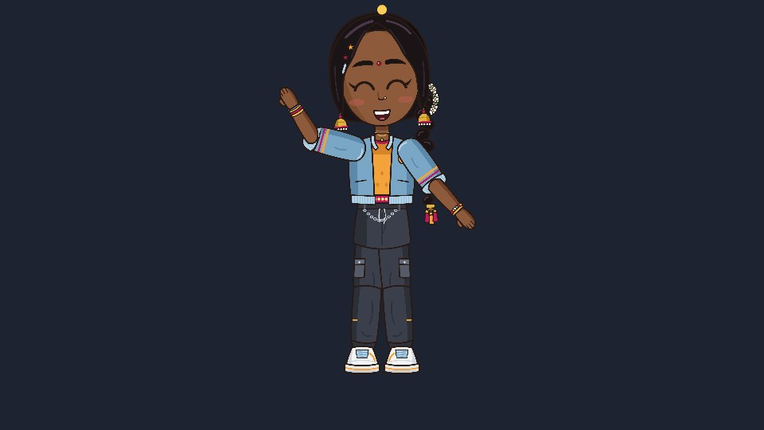

On YouTube someone asked how to add animated characters to Phaser *without* Phaser Editor. Good
news: you don't need it. Rigby2D for Phaser is a plain plugin, one file, and your character is a
game object like any sprite. Here is the whole thing, start to finish, with NILA.



## 1. Export your character

In Rigby2D, open your character (or *File ▸ Open demo… ▸ NILA*) and choose
*File ▸ Export ▸ Binary .skel + atlas (4.3)…*. You get three files: `nila.skel`, `nila.atlas` and
`nila.png`. Put them in an `assets` folder.

## 2. Get the plugin

In the editor, *File ▸ Get runtimes… ▸ Phaser ▸ ES module* saves `rigby2d-phaser-<version>.mjs`
(it is also on the [Releases page](https://github.com/jaisurya-dev-art/rigby2d/releases/latest)).
Rename it `rigby2d-phaser.mjs` and put it next to your game. The folder now looks like this:

```
my-game/
  index.html
  main.js
  rigby2d-phaser.mjs
  assets/
    nila.skel  nila.atlas  nila.png
```

## 3. A page that loads Phaser

`index.html` loads Phaser from its CDN and your game as a module:

```html
<!doctype html>
<html>
  <body style="margin: 0; background: #1b1b1b">
    <script src="https://cdn.jsdelivr.net/npm/phaser@3.90.0/dist/phaser.min.js"></script>
    <script type="module" src="./main.js"></script>
  </body>
</html>
```

The plugin works with Phaser 4 too.

## 4. The game

`main.js` registers the plugin, loads the character and puts her on stage:

```js
import { rigbyPhaser } from './rigby2d-phaser.mjs';

const { RigbyPlugin } = rigbyPhaser(Phaser);

class Level extends Phaser.Scene {
  preload() {
    this.load.rigby('nila', 'assets/nila.skel', 'assets/nila.atlas');
  }

  create() {
    // x, y (where her feet go), key, animation. It loops by default.
    this.nila = this.add.rigby(480, 520, 'nila', 'idle');
    this.nila.setScale(0.18);

    // Space: wave once, then back to idle with a soft crossfade.
    this.input.keyboard.on('keydown-SPACE', () => {
      this.nila.play('wave', false, 0.2);
      this.nila.queue('idle', true, 0.3);
    });

    // Keys you set in the editor's timeline arrive as events.
    this.nila.on('event', (entry, event) => console.log('event:', event.name));

    // A sparkle that follows her head bone.
    this.sparkle = this.add.circle(0, 0, 6, 0xffcc55);

    this.keys = this.input.keyboard.createCursorKeys();
  }

  update(time, delta) {
    if (this.keys.left.isDown) {
      this.nila.x -= 0.2 * delta;
      this.nila.flipX = true;
    } else if (this.keys.right.isDown) {
      this.nila.x += 0.2 * delta;
      this.nila.flipX = false;
    }
    const head = this.nila.boneWorld('head');
    this.sparkle.setPosition(head.x, head.y - 130);
  }
}

new Phaser.Game({
  type: Phaser.WEBGL,
  width: 960,
  height: 540,
  backgroundColor: '#1d2330',
  plugins: { scene: [{ key: 'RigbyPlugin', plugin: RigbyPlugin, mapping: 'rigby' }] },
  scene: Level,
});
```

The four lines that matter: `rigbyPhaser(Phaser)` gives you the plugin, the `plugins` entry
installs it, `this.load.rigby` loads the files, and `this.add.rigby` makes the character.

## 5. Run it

Browsers don't load modules from `file://`, so serve the folder with any local server:

```bash
npx serve .
```

Open the address it prints. Arrow keys walk her, Space waves, and the sparkle stays above her head
whatever she does.

## What just happened

- **`play(name, loop, mix)`** starts an animation, crossfading from the current one over `mix`
  seconds. **`queue`** lines up the next one, so a wave flows back into idle on its own.
- **`flipX`** turns her around, like any Phaser game object. Position, scale, rotation, alpha,
  depth and input all work as usual.
- **`boneWorld('head')`** is where a bone is in the scene, every frame. Hang a hat, a weapon,
  particles or a hit box on it.
- **Events** you key in the editor's timeline (footsteps, a sword hit) fire `'event'`, and
  `'complete'` tells you when an animation finishes.

Everything you set up in Rigby2D comes along: meshes, physics on her braid, IK, skins and blend
modes play exactly as in the editor.

## Even faster: the starter

Want it running in one minute? The editor's welcome screen has a **Phaser game starter**: NILA on a
stage, walking, waving and switching moods with crossfades. Or download it directly:
[rigby2d-phaser-starter.zip](/starters/rigby2d-phaser-starter.zip). Unzip, `npx serve .`, done.
Swap in your own export and you have your game's character.

The [Phaser guide](/docs/runtimes.html#phaser) lists everything a Rigby2D character can do. Stuck,
or made something? Tell us on [r/rigby2d](https://www.reddit.com/r/rigby2d/).
