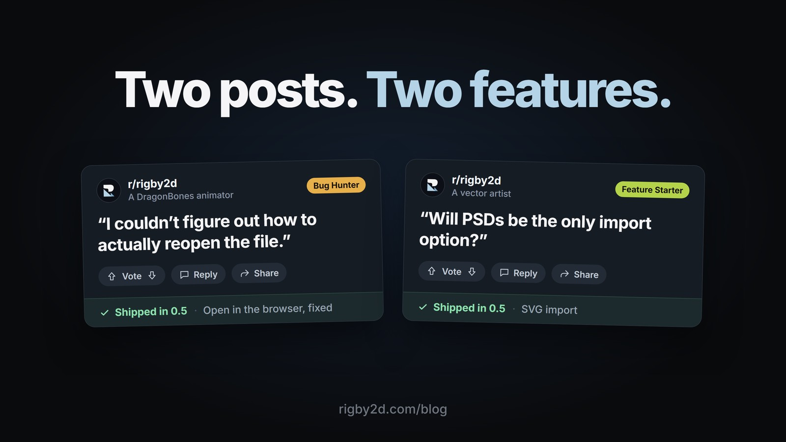

r/rigby2d got its first two posts from people trying Rigby2D on their own work, and each one found
something missing. Both are fixed in Rigby2D 0.5, out tomorrow, and both are already live in the
[browser editor](https://rigby2d.com/editor/).

## "I couldn't figure out how to actually reopen the file"

An animator who works in DragonBones brought a character over, rigged it, and wrote up everything
along the way. The bones and IK came across correctly. Opening the project again in the browser
editor was another story. *Open* showed a folder picker in which every file looked greyed out, the
browser then asked to "upload" the folder, and with a DragonBones export the editor could pick the
texture atlas (`_tex.json`) instead of the skeleton.

*Open* in the browser is now an ordinary file picker. Select the skeleton together with its image and
atlas, or drop them on the window, and Rigby2D works out which file is the project by reading them.
If something it needs is missing, it says which file, and asks for just that one.

## "Will PSDs be the only import option?"

The second post came from a graphic designer who draws in vector, in Inkscape on Linux and Affinity
on a Mac, and had never been able to afford Spine. Inkscape doesn't save layered PSDs, so on Linux,
Rigby2D was one step out of reach.

Now there is *File ▸ Import ▸ SVG…*. It reads a drawing the way a PSD is read: every layer becomes a
part, placed where it was drawn, ready for [AutoRig](/docs/autorig.html). Inkscape layers and
sublayers both count, as do the named groups Affinity and Illustrator export, and hidden layers come
in hidden, so spare parts are there to switch on. Because vector art is sharp at any size, the import
asks how large to draw it.

## While we were there

Testing the new sprite sheet export for 0.5 turned up two more things, so they're fixed too:

- **Sprite sheets are drawn on the GPU.** 120 large frames went from about thirty seconds to about
  four, and a sheet too big for one image now splits into several that Phaser and PixiJS load as one.
- **Every export reports back.** A dialog says where the files went, with *Show in folder* on desktop,
  or exactly what went wrong.

## Your turn

Both posters now wear new flairs on r/rigby2d: **Bug Hunter** and **Feature Starter**. The next ones
are waiting. Post what you make, what breaks, and what you wish Rigby2D did on
[r/rigby2d](https://www.reddit.com/r/rigby2d/): both of this week's fixes started as a post there.

Rigby2D 0.5 is out tomorrow.
