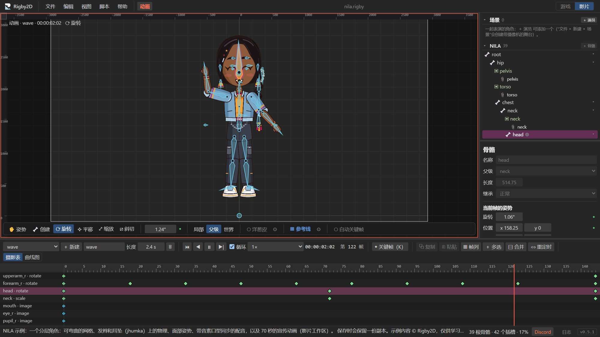

0.5 发布后，一位在 YouTube 上的中文动画师问了我们一个很实在的问题：*为什么只有菜单栏是中文的？*
他说得没错。我们的翻译只停留在窗口顶部，下面的每个面板、对话框和状态消息都还是英文。

我们答应他在下一个版本中提供完整的中文界面。现在，它完成了。

## 简体中文，全部覆盖

在 **Rigby2D 0.5.1** 中，打开 *偏好设置 ▸ 常规 ▸ 语言*，选择 **简体中文**，或者直接让 Rigby2D
跟随系统语言。你会在所有地方看到中文：

- **所有面板**：层级树、检查器、时间轴、摄影表和曲线图编辑器。
- **所有工具和对话框**：约束、网格和权重、AutoRig、重定向、姿势和面部控制、口型同步、场景、渲染以及精灵表导出。
- **所有消息**：状态栏提示、导入警告（包括 DragonBones 文件）和错误信息。
- **教程**：全部四节课，一步一步，从第一次点击到你的第一个动画。

翻译的界面文本从约 400 条增加到约 1,450 条。现在，只要有任何界面文本缺少中文翻译，测试就会失败，
所以今后的新功能也会同时带有中文。

日语、韩语、西班牙语和葡萄牙语目前仍只覆盖部分界面，它们是下一步。如果你会其中一种语言并愿意帮忙，
欢迎在 Discord 上告诉我们。

0.5.1 还带来了一些小改进：AutoRig 可以直接在它的窗口中导入 PNG，“帮助”菜单也为支持和社区链接
安排了新的位置。新版本即将发布。

## 我们的新家：Discord

Reddit 封禁了 r/rigby2d 之后（[事情经过见这里](https://rigby2d.com/blog/fck-reddit.html)），
我们把社区搬到了 Discord，那里已经成了一个很不错的交流场所。

**[加入 Rigby2D Discord](https://discord.gg/PGgaTwbNH)**

在 **#showcase** 展示你的作品，在 **#help** 提问，在 **#feature-requests** 参与决定下一个版本，
中文用户还有专属的 **#中文** 频道。编辑器中的 *文件 ▸ 分享到 Discord…* 可以把你的动画转成 GIF，
直接发布。

我们很快会在那里为美术创作者举办一项活动，敬请关注。

## 感谢 Gideon 和 Raphael

Rigby2D 在 GitHub Sponsors 上迎来了首批两位赞助者：
**[Gideon Bakx](https://github.com/bakx)** 和 **[Raphael C. Ramos](https://github.com/ph-developer)**。
他们是我们的首批 **创始支持者**，名字已经出现在[支持页面](https://rigby2d.com/fund/)和编辑器的
*帮助 ▸ 支持者* 中。

他们的支持将直接用于我们的第一个目标：以 Rigby2D 自己的名义为下载文件签名，这样 Windows 和 macOS
在安装时就不会再弹出警告。Gideon、Raphael：谢谢你们。在项目还没有什么成绩的时候，你们就选择了支持，
这对我们意义重大。

---

Rigby2D 免费且开源，并将一直如此。如果它对你有帮助，欢迎[支持这个项目](https://rigby2d.com/fund/)，
或在 [GitHub](https://github.com/jaisurya-dev-art/rigby2d) 上点一颗星。
